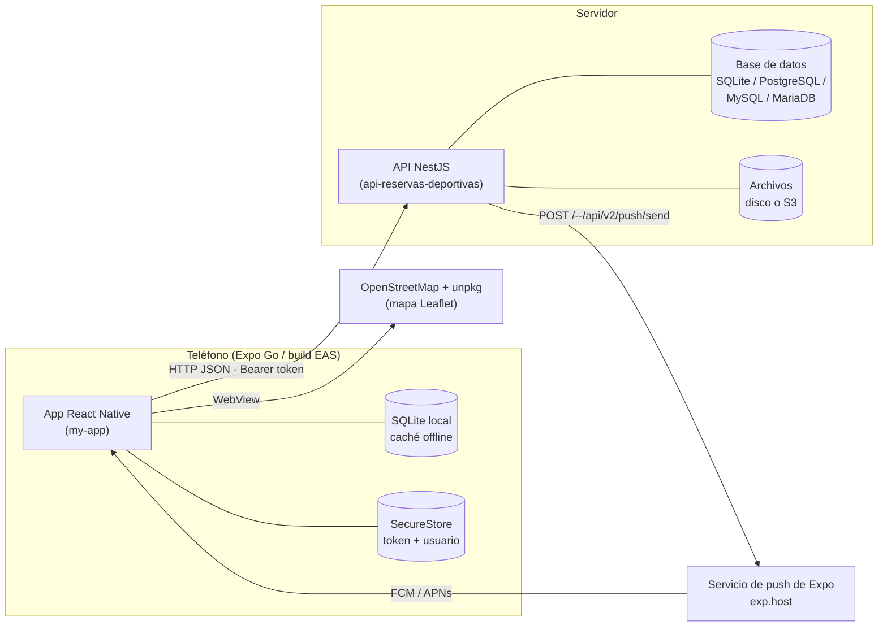
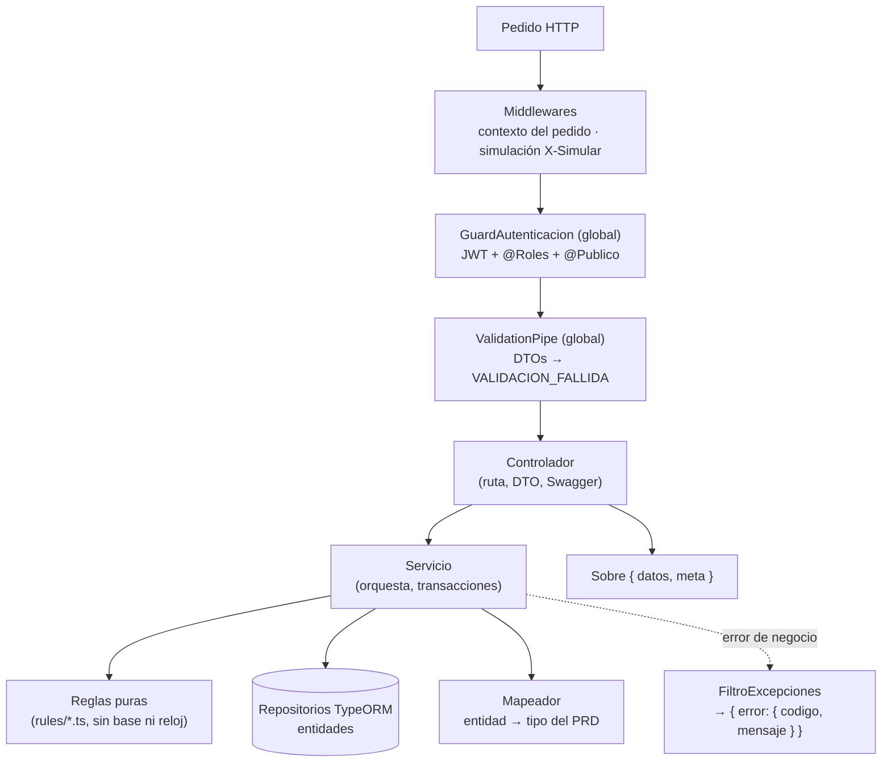
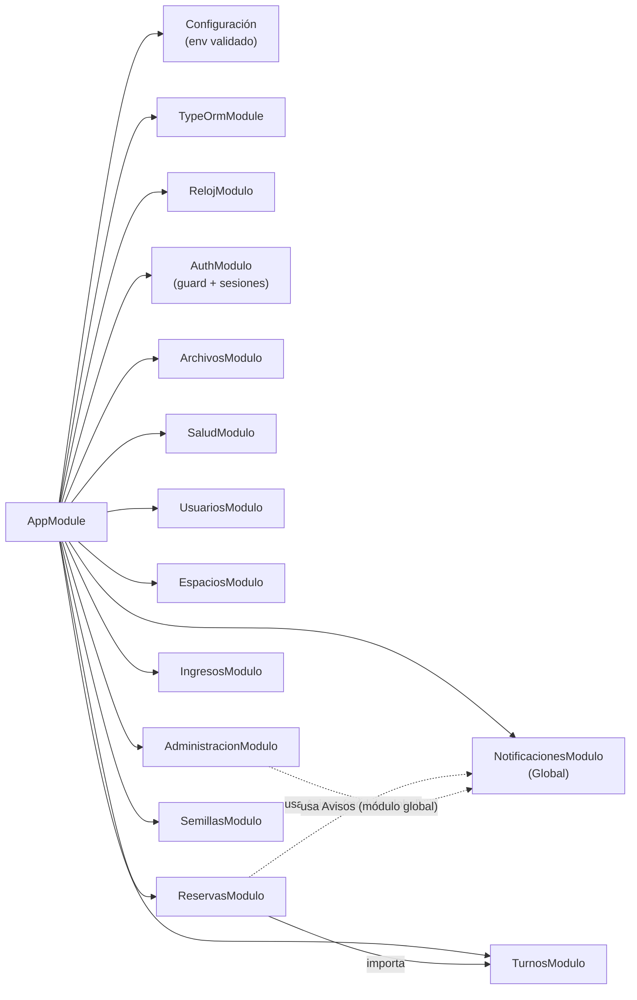
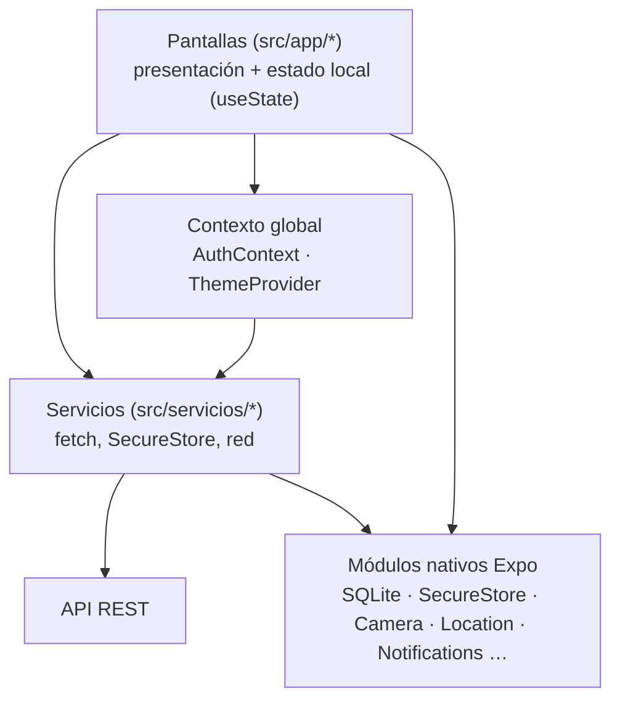
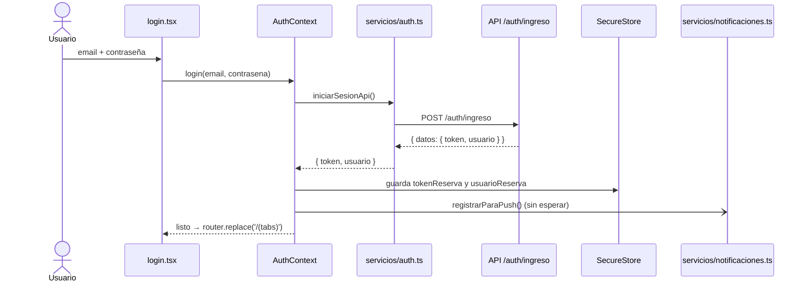
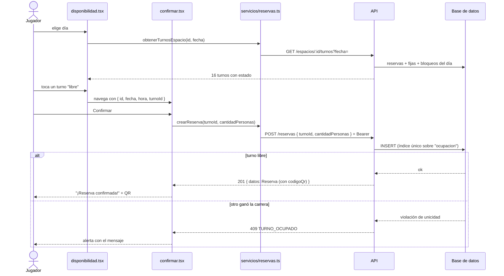
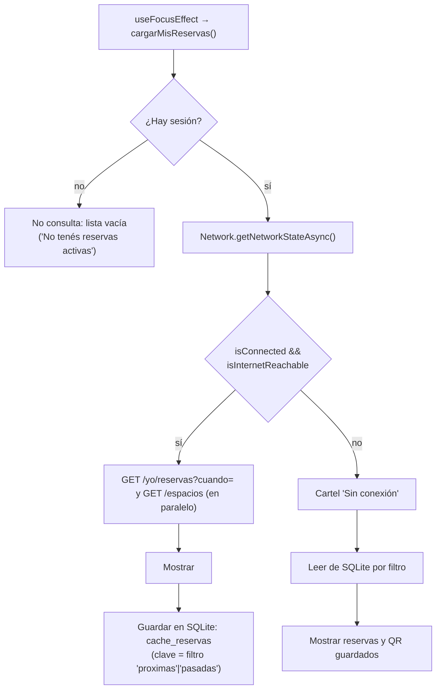
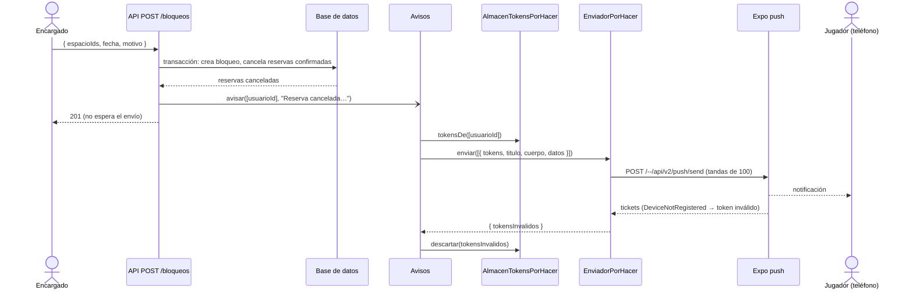

# 02 · Arquitectura

## 1. Vista general

El sistema es **cliente–servidor**: una app móvil (cliente) y una API REST (servidor) con su
base de datos. Un tercer actor, el servicio de push de Expo, entrega las notificaciones al
teléfono.



## 2. Stack tecnológico

### 2.1 App móvil (`my-app/`)

| Capa | Tecnología | Versión | Por qué |
|---|---|---|---|
| Framework | React Native | 0.86.3 | Pedido por el PRD (un solo código para Android e iOS) |
| Plataforma | Expo SDK | ~57 | Acceso simple a cámara, ubicación, notificaciones, etc. |
| Lenguaje | TypeScript | ~6.0 (modo `strict`) | Tipos del PRD compartidos con la API |
| Navegación | Expo Router | ~57 | Rutas por archivos, `typedRoutes` activado |
| Compilador | React Compiler | `experiments.reactCompiler` | Memoización automática |
| UI | `StyleSheet` + `@react-native-vector-icons/ionicons` | — | Pedido por el PRD (los íconos ya no vienen de `@expo/vector-icons`) |
| QR | `react-native-qrcode-svg` | 6.x | Dibuja el código de la reserva |
| Mapa | `react-native-webview` + Leaflet (CDN) | 13.x / 1.9.4 | No requiere clave de Google Maps |
| Datos locales | `expo-sqlite` | ~57 | Caché de reservas/galería para uso sin señal |
| Seguridad | `expo-secure-store`, `expo-local-authentication` | ~57 | Token en almacenamiento seguro; huella/PIN |
| Avisos | `expo-notifications`, `expo-device`, `expo-constants` | ~57 | Token de Expo y recepción de push |

Dependencias instaladas **sin uso en el código** (candidatas a quitar o a usar): `axios`, `zod`,
`react-hook-form`, `@hookform/resolvers`, `react-native-maps`, `expo-sensors`,
`expo-file-system` (se usa, pero mal; ver [08](08-estado-actual-y-deuda-tecnica.md)).

### 2.2 API (`api-reservas-deportivas/`)

| Capa | Tecnología | Versión | Por qué |
|---|---|---|---|
| Runtime | Node.js | ≥ 24 | Requisito del proyecto (`.nvmrc`) |
| Framework | NestJS | 12 | Módulos, inyección de dependencias, guards, pipes |
| ORM | TypeORM | 1.x | Un solo código para 4 motores |
| Base | better-sqlite3 · PostgreSQL 17 · MySQL 8.4 · MariaDB 11 | — | Elegible por `DB_MOTOR` |
| Sesión | `@nestjs/jwt` (HS256, 30 días) | — | Token sin estado |
| Contraseñas | `scrypt` de `node:crypto` | — | Sin dependencias nativas |
| Validación | `class-validator` + `class-transformer` | — | DTOs con mensajes en castellano |
| Documentación | `@nestjs/swagger` | — | `/docs` |
| Fechas | `date-fns` + `@date-fns/tz` | — | Hora de Argentina (UTC−3) |
| Archivos | disco local o S3 (`@aws-sdk/client-s3`) | — | Intercambiable (AWS, Supabase, R2, B2…) |
| Tests | Vitest + Supertest | 4.x | Unitarios y e2e |
| Calidad | oxlint, prettier, GitHub Actions | — | `pnpm verificar` |
| Contenedores | Docker + Compose | — | `docker compose up` |

## 3. Arquitectura de la API

### 3.1 Capas



Principios que se ven en el código:

1. **Reglas puras separadas** (`src/modules/*/rules/`): funciones sin acceso a la base ni al
   reloj (`armarGrilla`, reglas de reserva, de ingreso, de bloqueos). Son las que se prueban
   con tablas de casos.
2. **El reloj es inyectable** (`src/common/clock`): la API puede "congelar" la hora
   (`RELOJ_FIJO`) para reproducir casos como "el turno ya empezó".
3. **El mapeador es la única puerta de salida**: cada módulo convierte sus entidades a los
   tipos del PRD; la API nunca filtra campos internos (hash de contraseña, columna `ocupacion`).
4. **Errores como catálogo cerrado** (`common/errors/catalog.ts`): cada error tiene un
   `codigo` estable, un HTTP y un mensaje listo para mostrar en pantalla.
5. **Seguro por defecto**: el guard global exige sesión en todo, salvo lo marcado `@Publico()`.

### 3.2 Módulos de NestJS



`NotificacionesModulo` es `@Global()`: cualquier módulo puede inyectar `Avisos` sin importarlo.
`ReservasModulo` importa `TurnosModulo` para reutilizar el cálculo de la grilla al reservar.
Cada módulo registra sus propias entidades con `TypeOrmModule.forFeature([...])`.

## 4. Arquitectura de la app

### 4.1 Estructura de carpetas

```
my-app/src/
├── app/                      Rutas (Expo Router: cada archivo es una pantalla)
│   ├── _layout.tsx           Raíz: ThemeProvider → AuthProvider → Stack + toques de aviso
│   ├── index.tsx             Pantalla de entrada ("Bienvenido": ingreso + huella)
│   ├── login.tsx             Ingreso (usa AuthContext)
│   ├── registro.tsx          Alta de cuenta
│   ├── (tabs)/               Grupo de pestañas
│   │   ├── _layout.tsx       Barra inferior + cabecera con menú (escáner, mapa)
│   │   ├── index.tsx         "Mis reservas" (próximas / historial / offline)
│   │   ├── espacios.tsx      Catálogo con filtros
│   │   ├── perfil.tsx        Perfil, tema, salir
│   │   ├── mapa.tsx          Mapa de complejos (oculta en la barra: se abre desde el menú ☰)
│   │   ├── escaner.tsx       Escáner QR (oculta en la barra: se abre con el ícono QR de la cabecera)
│   │   └── estado-cancha.tsx Reporte de foto (oculta; ningún botón lleva a ella)
│   └── espacio/              Flujo de reserva (fuera de las pestañas)
│       ├── [id].tsx          Ficha del espacio
│       ├── disponibilidad.tsx  Grilla de turnos
│       └── confirmar.tsx     Confirmación + QR
├── contexto/AuthContext.tsx  Estado global de sesión
├── providers/ThemeProvider.tsx  Estado global del tema
├── hooks/use-theme.ts        `useTema()` (acceso a la paleta)
├── servicios/                Única capa que habla con la red
│   ├── auth.ts               /auth/*, /yo, /dispositivos
│   ├── reservas.ts           /espacios, /deportes, /reservas, favoritos
│   ├── notificaciones.ts     Permiso, token de Expo, alta/baja
│   └── db.ts                 SQLite/kv (helpers sin uso actual)
├── tipos/index.ts            Tipos del PRD (copia literal)
└── mocks/datos.ts            Datos falsos del PRD (sin uso actual)
```

Archivos `.txt` en `app/` y `servicios/` (`layout.txt`, `reservas.txt`, `mapa.txt`,
`notificaciones.txt`) son **copias de respaldo de versiones anteriores**; no forman parte de la
app. Los componentes de `src/components/` y `src/constants/` son **remanentes de la plantilla de
Expo** y no se usan.

### 4.2 Capas



Reglas de la capa de servicios (PRD): todas las funciones son **asíncronas**, devuelven los
**tipos del PRD** y las pantallas no importan datos falsos. Excepciones documentadas en [08](08-estado-actual-y-deuda-tecnica.md):
varias pantallas llaman directamente a SQLite o `expo-file-system`.

### 4.3 Estado y persistencia en el teléfono

| Dato | Dónde vive | Quién lo escribe | Quién lo lee |
|---|---|---|---|
| Token de sesión (`tokenReserva`) | `expo-secure-store` | `AuthContext` (ingreso/registro), borrado en `logout` | `servicios/*` (en cada pedido), `AuthContext` al arrancar |
| Usuario (`usuarioReserva`, JSON) | `expo-secure-store` | `AuthContext`, `perfil.tsx` (al editar) | `AuthContext` al arrancar |
| Token de Expo (`tokenPushExpo`) | `expo-secure-store` | `servicios/notificaciones.ts` | el mismo (para dar de baja) |
| Reservas y espacios (caché) | SQLite `mis_reservas_final.db`, tabla `cache_reservas` | `(tabs)/index.tsx` | `(tabs)/index.tsx` sin conexión |
| Galería de la cancha | SQLite `canchas_galeria.db`, tabla `galeria` | `espacio/[id].tsx` | `espacio/[id].tsx` |
| Tema elegido | Estado de React en `ThemeProvider` | `perfil.tsx` | toda la app — **no persiste** al cerrar la app |
| Sesión y usuario actuales en memoria | `useState` en `AuthContext` | `AuthContext` | `useAuth()` |

## 5. Flujos principales

### 5.1 Ingreso



### 5.2 Reservar un turno



### 5.3 "Mis reservas" con y sin conexión



### 5.4 Bloqueo del encargado → push al jugador



El diseño completo está en [05](05-notificaciones-push.md).

## 6. Seguridad

| Tema | Implementación | Dónde |
|---|---|---|
| Autenticación | JWT HS256, vence a los 30 días, sin refresh | `common/auth/sessions.ts` |
| Autorización | Guard global; `@Roles('encargado','administrador')` por endpoint | `common/auth/session-guard.ts` |
| Contraseñas | `scrypt` con sal aleatoria de 16 bytes, comparación en tiempo constante | `common/auth/passwords.ts` |
| Enumeración de usuarios | Se verifica contra un hash de relleno si el email no existe (iguala tiempos) | `users.service.ts` |
| Validación de entrada | `whitelist` + `forbidNonWhitelisted`: un campo de más es error | `setup-app.ts` |
| Token en el teléfono | `expo-secure-store` (nunca `kv-store`, como exige el PRD) | `AuthContext.tsx` |
| Acceso al escáner | Huella/PIN si el teléfono la tiene (no hay control de **rol**) | `escaner.tsx` |
| Producción | Con `ENTORNO=publicado` la API no arranca con SQLite, archivos en disco, `JWT_SECRETO` débil o simulación activa | `config/environment.ts` |
| Transporte | La app usa `http://` en desarrollo; producción debería ser `https://` | — |
| Secretos en el repo | La pantalla `app/index.tsx` trae credenciales de demo precargadas | ver [08](08-estado-actual-y-deuda-tecnica.md) |

## 7. Entornos y despliegue

| Entorno | Base | Archivos | Cómo se levanta |
|---|---|---|---|
| Desarrollo local | SQLite (`datos/api.sqlite`) | disco (`archivos/`) | `pnpm dev` |
| Docker | SQLite o PostgreSQL / MySQL / MariaDB | disco o S3Proxy | `docker compose up` (+ `-f compose.<motor>.yaml`) |
| Publicado | PostgreSQL (Supabase, esquema `api`) | S3 (Supabase Storage) | Render (`render.yaml`) |

La app se entrega con **build de producción de EAS** (PRD). En este repo **todavía no hay
`eas.json`** ni identificador de aplicación definitivo (`com.anonymous.myapp`): ver [08](08-estado-actual-y-deuda-tecnica.md).

## 8. Decisiones de diseño y sus razones

| Decisión | Alternativas | Razón |
|---|---|---|
| La grilla se calcula **en el servidor** | Calcularla en la app con reservas + fijas + bloqueos | Es la parte difícil del problema; en un solo lugar evita inconsistencias y se prueba con tests |
| El turno **no se guarda**: se calcula y su id es determinístico | Tabla de turnos pre-generados | No hay que generar ni mantener filas; el id se desarma para saber espacio/fecha/hora |
| Doble reserva evitada con **índice único** (`ocupacion`, `NULL` si está cancelada) | Chequear antes de insertar | Un chequeo previo falla con pedidos simultáneos; la base es la única fuente confiable |
| `POST /reservas` **idempotente** | 409 al reintentar | Con mala señal el cliente reintenta; devolver la misma reserva evita errores falsos |
| Caché offline como **JSON en SQLite** (clave = filtro) | Tablas normalizadas; `AsyncStorage` | Simple y suficiente para "ver mi reserva y mi QR sin señal"; el PRD pide SQLite |
| Mapa con **Leaflet en un WebView** | `react-native-maps` | No requiere claves de Google ni build nativo propio en Expo Go; cuesta: necesita internet |
| Sesión en **Context** | Redux/Zustand | Estado chico (usuario + token); alcanza con Context |
| Push enviadas **sin bloquear** la respuesta | Enviar y esperar | Un fallo de Expo no debe romper "bloquear turnos" ni "cancelar" |
| Estilos con `StyleSheet` + paleta en Context | Unistyles / NativeWind | Cumple el PRD sin dependencias extra |
