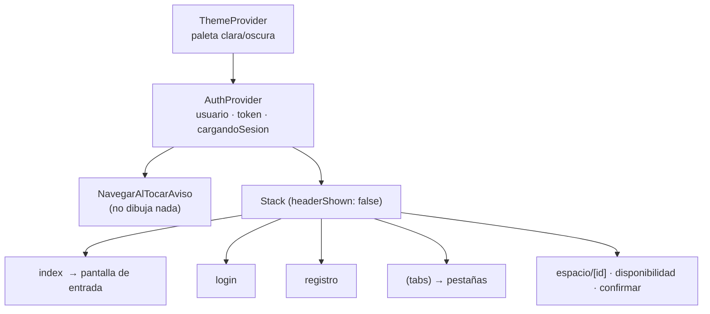
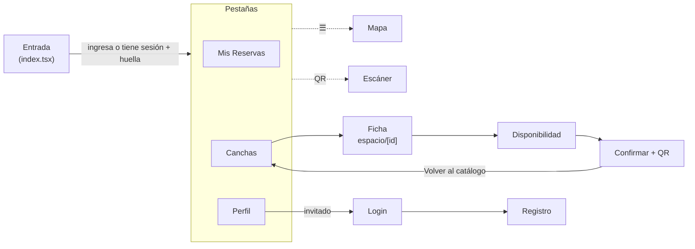

# 04 · La app móvil (`my-app/`)

Este es el trabajo propio del grupo. El documento va de lo general (arranque, navegación,
estado) a lo particular (pantalla por pantalla y función por función). Las rutas de archivo son
relativas a `my-app/src/`.

## 1. Arranque y composición de la app

`package.json` declara `"main": "expo-router/entry"`: Expo Router recorre `src/app/` y arma las
rutas a partir de los archivos. El árbol de componentes raíz (`app/_layout.tsx`) es:

- **`ThemeProvider`** y **`AuthProvider`** son los dos contextos globales. Todo lo demás es
  estado local de cada pantalla (`useState`).
- `app.json` activa `typedRoutes` (las rutas se chequean al compilar) y `reactCompiler`.
- `scheme: "myapp"` define el esquema de enlaces profundos.

### 1.1 Navegación

| Ruta | Archivo | Tipo | Se llega desde |
|---|---|---|---|
| `/` (entrada) | `app/index.tsx` | Pantalla raíz del Stack | Arranque de la app |
| `/login` | `app/login.tsx` | Stack | Botón "Iniciar sesión" del perfil de invitado; tras cerrar sesión |
| `/registro` | `app/registro.tsx` | Stack | Enlace desde `login` |
| `/(tabs)` → Mis Reservas | `app/(tabs)/index.tsx` | Pestaña 1 | Tras ingresar; toque de un aviso de reserva cancelada |
| `/(tabs)/espacios` | `app/(tabs)/espacios.tsx` | Pestaña 2 | Tras login/registro; "Volver al catálogo" |
| `/(tabs)/perfil` | `app/(tabs)/perfil.tsx` | Pestaña 3 | Barra inferior |
| `/mapa` | `app/(tabs)/mapa.tsx` | Pestaña **oculta** (`href: null`) | Menú ☰ de la cabecera |
| `/escaner` | `app/(tabs)/escaner.tsx` | Pestaña **oculta** | Ícono QR de la cabecera |
| `/estado-cancha` | `app/(tabs)/estado-cancha.tsx` | Pestaña **oculta** | **Ningún enlace** (pantalla huérfana) |
| `/espacio/[id]` | `app/espacio/[id].tsx` | Stack | Tarjeta del catálogo; toque de un aviso "Se liberó un turno" |
| `/espacio/disponibilidad` | `app/espacio/disponibilidad.tsx` | Stack | Botón "Ver disponibilidad" de la ficha |
| `/espacio/confirmar` | `app/espacio/confirmar.tsx` | Stack | Toque de un turno libre |

> **Trampa conocida:** `app/index.tsx` y `app/(tabs)/index.tsx` resuelven ambas a la URL `/`
> (los grupos `(...)` no cuentan en la URL). El código siempre navega al grupo con
> `router.replace('/(tabs)')`; nunca hay que navegar a `'/'` esperando llegar a las pestañas.

### 1.2 Flujo de pantallas

## 2. Estado global

### 2.1 `contexto/AuthContext.tsx`

Contrato expuesto por `useAuth()`:

| Campo | Tipo | Significado |
|---|---|---|
| `usuario` | `Usuario \| null` | Datos del usuario logueado (tipo del PRD) |
| `token` | `string \| null` | JWT de la API |
| `cargandoSesion` | `boolean` | `true` hasta terminar de leer la sesión guardada |
| `login(email, contrasena)` | `Promise<void>` | Llama a la API, guarda sesión, registra el teléfono para push |
| `registro(nombre, email, telefono, contrasena)` | `Promise<void>` | Igual, creando la cuenta |
| `logout()` | `Promise<void>` | Da de baja el teléfono, borra la sesión y va a `/login` |

Funcionamiento:

1. Al montar, `cargarSesionGuardada()` lee `tokenReserva` y `usuarioReserva` de `SecureStore`;
   si ambos existen, los carga en estado y llama a `registrarParaPush()` (sin `await`).
   `cargandoSesion` pasa a `false` en un `finally`.
2. `login`/`registro` llaman a `servicios/auth.ts`, guardan token y usuario en estado **y** en
   `SecureStore`, y disparan `registrarParaPush()` sin esperar (no demora el ingreso).
3. `logout` ejecuta **en este orden**: `darDeBajaPush()` (necesita el token vigente) → limpia
   el estado → borra las dos claves → `router.replace('/login')`.
4. `useAuth()` lanza un error si se usa fuera del `AuthProvider`.

> **Sesión sólo en el cliente:** no se valida el token al arrancar. Si el token venció (30
> días), el usuario sigue "logueado" en la app hasta que un pedido devuelva `NO_AUTENTICADO`.

### 2.2 `providers/ThemeProvider.tsx` + `hooks/use-theme.ts`

- Dos paletas (`paletaClara`, `paletaOscura`) con claves `background, surface, text, muted,
  border, accent`.
- `modoManual`: `'sistema' | 'claro' | 'oscuro'`. `esOscuro` se deriva de `useColorScheme()` del
  sistema cuando el modo es `'sistema'`.
- `useTema()` devuelve `{ paleta, esOscuro, modoManual, cambiarTema }`. Todas las pantallas
  pintan con `paleta.*` en línea (`style={[estilos.x, { color: paleta.text }]}`).
- **No persiste** la elección: al cerrar la app vuelve a `'sistema'`.
- `ThemeContext` está tipado `any` (sin tipo estricto).
- `theme/colors.ts` define otra paleta (`darkColors`/`lightColors`) que **no se usa**.

## 3. Capa de servicios

### 3.1 `servicios/auth.ts`

| Función | Pedido | Notas |
|---|---|---|
| `BASE_URL` | — | Dirección de la API escrita a mano (`http://192.168.1.6:3000`). Se exporta y la usa `notificaciones.ts` |
| `iniciarSesionApi(email, contrasena)` | `POST /auth/ingreso` | Devuelve `datos` (`{ token, usuario }`). Cualquier fallo → `Error('Credenciales inválidas')` |
| `registrarUsuarioApi(nombre, email, telefono, contrasena)` | `POST /auth/registro` | Fallo → mensaje genérico ("El email podría estar en uso") |
| `actualizarPerfilApi({ nombre?, telefono? })` | `PATCH /yo` | Exige token; devuelve el `Usuario` actualizado |
| `registrarDispositivoApi(tokenExpo, plataforma)` | `POST /dispositivos` | Sin sesión no hace nada; lanza error si la API responde mal |
| `darDeBajaDispositivoApi(tokenExpo)` | `DELETE /dispositivos/:token` | `encodeURIComponent` porque el token lleva corchetes |

Todas empiezan con `verificarConexion()` (abajo) salvo las de dispositivos.

### 3.2 `servicios/reservas.ts`

`API_URL` es otra constante con la misma IP (duplicada respecto de `BASE_URL`).
`verificarConexion()` usa `Network.getNetworkStateAsync()` y lanza
`'Sin conexión a internet o red local.'` si `isConnected` es falso.

| Función | Pedido | Comportamiento ante error |
|---|---|---|
| `obtenerEspacios()` | `GET /espacios` | Devuelve `[]` (traga el error) |
| `obtenerEspacioPorId(id)` | `GET /espacios/:id` | Devuelve `null` |
| `obtenerTurnosPorDia(espacioId, fecha)` | `GET /espacios/:id/turnos?fecha=` | Devuelve `[]` (sin uso) |
| `obtenerReservasFijas(espacioId)` | `GET /fijas?espacioId=` | Devuelve `[]` (es endpoint de personal; sin uso) |
| `crearReserva(turnoId, cantidadPersonas)` | `POST /reservas` + Bearer | Lanza error; `'NO_AUTENTICADO'` si no hay token |
| `cancelarReserva(reservaId)` | `POST /reservas/:id/cancelacion` | Lanza con `error.mensaje` de la API |
| `obtenerMisReservas(cuando)` | `GET /yo/reservas?cuando=proximas\|pasadas` | Lanza error |
| `obtenerMisFavoritos()` | `GET /yo` (campo `espaciosFavoritos`) + `GET /espacios` | Cruza ids con el catálogo; ver abajo |
| `alternarFavoritoApi(espacioId, marcar)` | `PUT` / `DELETE /yo/espacios-favoritos/:id` | Lanza error |
| `obtenerTurnosEspacio(espacioId, fecha?)` | `GET /espacios/:id/turnos?fecha=` | Lanza error. **Es la que usa la grilla** |
| `obtenerDeportes()` | `GET /deportes` | Devuelve `[]` |
| `registrarIngresoApi(codigoQr, espacioId)` | — | **SIMULADA**: espera 500 ms y devuelve datos falsos |
| `obtenerComplejosApi()` | — | **SIMULADA** (sin uso) |
| `obtenerMisReservasApi()` | — | **SIMULADA** (sin uso) |

Detalles de implementación que conviene saber explicar:

- **Desempaquetado:** la API envuelve todo en `{ datos }`; cada función devuelve `json.datos`.
- **`obtenerMisFavoritos`:** pide `/yo` y toma `espaciosFavoritos` (ids). Si ya vinieran
  objetos con `nombre`, los usa; si no, normaliza a ids de texto y filtra el catálogo
  (`obtenerEspacios()`). Hay una ruta alternativa `/yo/espacios-favoritos` que la API real no
  expone para `GET` (es código defensivo).
- **Duplicación:** `obtenerTurnosPorDia` y `obtenerTurnosEspacio` hacen lo mismo; la grilla usa
  la segunda.
- **Manejo de errores inconsistente:** `crearReserva` lee `errorData.message || errorData.error`,
  pero la API responde `{ error: { codigo, mensaje } }`: ver el error **[B-01]** en
  [08](08-estado-actual-y-deuda-tecnica.md).

### 3.3 `servicios/notificaciones.ts`

Detallado en [05](05-notificaciones-push.md). Resumen: al importarse registra
`setNotificationHandler` (mostrar banner/lista/sonido con la app abierta); `registrarParaPush()`
pide permiso, obtiene el token de Expo y lo anota en la API; `darDeBajaPush()` lo da de baja.

### 3.4 `servicios/db.ts` (sin uso)

Define `iniciarBaseDeDatos`, `guardarEspaciosEnTelefono`/`leerEspaciosDelTelefono`,
`guardarReservasEnTelefono`/`leerReservasDelTelefono` (SQLite) y
`guardarPreferenciaComplejo`/`leerPreferenciaComplejo` (`kv-store`). **Ninguna pantalla los
importa**: cada pantalla abre su propia base. Es el "diseño previsto" por el PRD (servicio de
persistencia) que quedó sin conectar.

## 4. Pantallas, una por una

### 4.1 Entrada — `app/index.tsx` (`LoginScreen`)

Pantalla "Bienvenido". Usa `AuthContext` como el resto de la app.

- **Estado:** `email`, `password` (precargados con credenciales de demo), `cargando`, y un
  `useRef` `biometriaPedida` que evita pedir la huella dos veces.
- **Con sesión guardada:** un `useEffect` espera `cargandoSesion === false`; si hay `token` y no
  se pidió la huella, llama a `verificarSesion()`. Esta consulta
  `LocalAuthentication.hasHardwareAsync()` e `isEnrolledAsync()`: si el teléfono tiene huella/PIN
  enrolado, pide `authenticateAsync` ("Ingresá a tus reservas") y, si tiene éxito, hace
  `router.replace('/(tabs)')`; si falla muestra "Acceso denegado". Si no hay biometría, entra
  directo.
- **`iniciarSesion()`:** valida que haya datos; vibra (`Haptics.impactAsync(Heavy)`); marca
  `biometriaPedida = true` (no pedir huella tras escribir la contraseña); `await login(...)` y
  `router.replace('/(tabs)')`. Un error se muestra con `Alert`.

### 4.2 `app/login.tsx` y `app/registro.tsx`

- **Login:** formulario email/contraseña (controlados con `useState`); `login()` y luego
  `router.replace('/(tabs)/espacios')`. Botón ✕ para volver. Enlace a registro.
- **Registro:** nombre, email, teléfono (obligatorio en este proyecto), contraseña; llama a
  `registro()` y navega a `/(tabs)/espacios`. Valida sólo que no haya campos vacíos (la API
  valida el resto).

### 4.3 Catálogo — `(tabs)/espacios.tsx`

- **Carga:** `useEffect` → `Promise.all([obtenerEspacios(), obtenerDeportes()])`; `cargando`
  controla un `ActivityIndicator`.
- **Filtros (en el cliente):** `deporteFiltro` y `complejoFiltro` (`string | null`). Los
  complejos se derivan con `new Set(espacios.map(e => e.complejo))`. `espaciosFiltrados` aplica
  ambos con `&&`. Los botones se dibujan con `renderFiltroBoton`.
- **Lista:** `FlatList` con tarjetas (`renderEspacio`): imagen, nombre, precio `$X/h`,
  complejo, superficie y la etiqueta "Luz nocturna" si `iluminacion`. Al tocar:
  `router.push({ pathname: '/espacio/[id]', params: { id } })`.
- **Observación:** el filtrado se hace en la app, aunque la API soporta `?deporteId=&complejo=`.

### 4.4 Ficha — `espacio/[id].tsx` (`FichaEspacioScreen`)

La pantalla más compleja. Lee el `id` con `useLocalSearchParams`.

| Bloque | Cómo funciona |
|---|---|
| Carga | `useFocusEffect` → `cargarDetalle()`: `obtenerEspacioPorId`, luego `obtenerMisFavoritos` para saber si el corazón va lleno |
| Favorito | `manejarFavorito()`: **actualización optimista** (cambia el estado y llama a `alternarFavoritoApi`; si falla, revierte y muestra `Alert`) |
| Galería comunitaria | SQLite propia `canchas_galeria.db`, tabla `galeria(espacioId PK, fotos_json)`. `useEffect` abre/crea la base (`dbLista`); `cargarGaleriaLocal()` lee y normaliza (string → `{uri, tipo:'image'}`) |
| "Reportar" | `reportarEstado()`: pide permiso de galería (`ImagePicker.requestMediaLibraryPermissionsAsync`), abre el selector (imágenes o videos, calidad 0,7), antepone el archivo a la lista y la guarda como JSON con `INSERT OR REPLACE`. Muestra "¡Reporte subido!" |
| Video | `ReproductorCancha` usa `useVideoPlayer` + `VideoView` (`loop`). `ReproductorMini` (silenciado) para videos de la galería |
| Caché de medios | Intenta guardar la primera imagen y el video en el teléfono con `expo-file-system` (`esp_img_<id>.jpg`, `esp_vid_<id>.mp4`) y usar la copia local |
| CTA | Botón fijo "Ver disponibilidad" → `/espacio/disponibilidad?id=` |

Puntos para tener claros:

- La galería "de la comunidad" es **local a cada teléfono**: no se sube a la API ni la ven otros
  usuarios, aunque el mensaje diga "reporte subido". La API tiene `POST /archivos` para esto.
- La caché de medios usa `(FileSystem as any).documentDirectory` y `getInfoAsync`/`downloadAsync`
  (API **vieja** de `expo-file-system`). En el SDK 57 esas funciones lanzan error o no existen,
  y `documentDirectory` queda `undefined`: la función sale antes de cachear. Resultado: el
  video e imagen **se piden siempre por red**. Error **[B-04]** en [08](08-estado-actual-y-deuda-tecnica.md).
- La conexión SQLite está en una variable de módulo (`let db`) para no abrirla en cada render.

### 4.5 Disponibilidad — `espacio/disponibilidad.tsx`

- **`generarProximosDias()`:** arma 7 objetos `{ iso, nombre, numero }` (el primero es "Hoy").
  El `iso` sale de `fecha.toISOString().split('T')[0]` → **fecha en UTC**: ver **[B-02]**.
- **Estado:** `fechaSeleccionada` (por defecto hoy), `turnosReales` (`any[]`), `cargando`.
- **Carga:** `useFocusEffect` con una bandera `estaActivo` para ignorar respuestas tardías
  si la pantalla perdió el foco o cambió el día (evita condiciones de carrera). Llama a
  `obtenerTurnosEspacio(id, fechaSeleccionada)`.
- **`calcularEstadoVisual(turno)`:** si el día es anterior a hoy → `'pasado'`; si es hoy y
  `horaTurno <= horaActual` → `'pasado'`; si no, usa `turno.estado`. Sólo mira la **hora**
  (no los minutos): un turno de las 14:00 pasa a "Finalizado" apenas son las 14:00.
- **`renderBotonEstado(estado)`:** `libre` → verde "Disponible"; `reservado` y `fijo` →
  "Ocupado" (la app **no distingue** una fija de una reserva); `mantenimiento` → ámbar;
  `pasado` → "Finalizado".
- **Interacción:** sólo los turnos `libre` son tocables (`disabled={estadoVisual !== 'libre'}`);
  navega a `confirmar` con `{ id, fecha, hora, turnoId }`.
- No muestra el `motivoBloqueo` ni el precio del turno (la API los envía).

### 4.6 Confirmación — `espacio/confirmar.tsx`

- Recibe `id, fecha, hora, turnoId` por parámetros de ruta; carga el espacio.
- **`confirmarReservaApi()`:** `procesando = true` (deshabilita el botón),
  `crearReserva(turnoId, espacio?.capacidad || 10)`, guarda `reservaGenerada.codigoQr` en
  `qrData` y `confirmado = true`. Errores: `'NO_AUTENTICADO'` → "Falta iniciar sesión"; otros →
  "Error del servidor" con el mensaje.
- **Vista de éxito:** ícono de check, texto "Te esperamos el {fecha} a las {hora}…" y el QR
  dibujado con `react-native-qrcode-svg` (`<QRCode value={qrData} size={150} />`). Botón
  "Volver al catálogo" (`router.navigate('/(tabs)/espacios')`).
- **Limitación:** la cantidad de personas **no se pregunta**: siempre se reserva por la
  capacidad total del espacio. Pendiente respecto del PRD ("indicando… cuántos van a ser").
- Muestra "Total a pagar: $X" y aclara que el pago es en el complejo (la app no cobra).

### 4.7 Mis Reservas — `(tabs)/index.tsx`

Pantalla clave del requisito offline.

1. **Filtro** `proximas | historial` (`pasadas` en la API) con dos botones.
2. **`cargarMisReservas()`** (se ejecuta con `useFocusEffect` cada vez que la pestaña gana el
   foco, o cambia `filtro`/`usuario`). Sin `usuario`, no consulta.
3. **Con conexión** (`isConnected && isInternetReachable`): `Promise.all` de
   `obtenerMisReservas(filtro)` y `obtenerEspacios()`; arma un mapa `{ [espacioId]: Espacio }`
   y lo **guarda en SQLite**: base `mis_reservas_final.db`, tabla
   `cache_reservas(filtro PK, reservas_json, espacios_json)`, con `INSERT OR REPLACE`.
   Usa las variantes **síncronas** (`openDatabaseSync`, `execSync`, `runSync`) "para evitar
   crasheos en Android".
4. **Sin conexión:** cartel "⚠️ Sin conexión. Mostrando reservas guardadas." y lectura de la
   fila del filtro actual. Primera vez sin caché → lista vacía.
5. **Tarjeta de reserva:** estilo "wireframe" del PRD. Título "Mi reserva – ESTADO", nombre de la
   cancha, fecha/hora, complejo, precio ("se paga en el lugar"), **código QR** (si no está
   cancelada) y botones "Cómo llegar" y "Cancelar reserva".
6. **`formatearTurno(turnoId)`:** desarma el id `tur-esp-02-20260919-19` por `split('-')`:
   `partes[3]` = fecha `AAAAMMDD`, `partes[4]` = hora. Depende del formato D1 (si cambia el
   id, se rompe). `horaFin` = hora + 1.
7. **Cómo llegar:** `Linking.openURL` a una búsqueda de Google Maps del complejo + ", Villaguay".
8. **Cancelar:** `Alert` de confirmación → `cancelarReserva(id)` → recarga. El botón sólo se
   ve en "próximas" y **con conexión**. El texto "hasta las 15:00 de hoy" es **fijo** (no
   calculado desde `cancelableHasta`): **[B-06]**.

### 4.8 Escáner — `(tabs)/escaner.tsx`

1. **`inicializarEscaner()`:** si hay huella/PIN, exige `authenticateAsync`; luego carga los
   espacios para que el encargado elija **qué cancha controla**.
2. **Permiso de cámara** con `useCameraPermissions()`; si no está concedido, muestra una
   pantalla explicativa con "Otorgar permiso".
3. **`CameraView`** a pantalla completa, sólo `qr` (`barcodeTypes: ["qr"]`).
   `onBarcodeScanned` se desactiva mientras `escaneando` es `true` (evita lecturas repetidas).
4. **`manejarEscaneo({ data })`:** llama a `registrarIngresoApi(data, espacioSeleccionado)`;
   éxito → `Haptics.notificationAsync(Success)` + "¡Ingreso autorizado!"; error →
   `Haptics.notificationAsync(Error)` + "Ingreso rechazado".
5. **⚠️ `registrarIngresoApi` es una simulación** (siempre "éxito"): la API real
   (`POST /ingresos`) **no se llama**. Además, **no se verifica el rol**: cualquier usuario
   (incluso invitado) llega al escáner por el ícono QR. **[B-03]**.

### 4.9 Mapa — `(tabs)/mapa.tsx`

- Agrupa los espacios por `complejo` usando las `coordenadas` del primer espacio de cada
  complejo (`Record<string, Complejo>`), con la lista de canchas.
- **`armarHtml(complejos, usuario)`** genera una página HTML con **Leaflet 1.9.4** (desde
  `unpkg.com`) y mosaicos de **OpenStreetMap**; se muestra en un `WebView`. Cada complejo es un
  marcador con popup ("N canchas disponibles"); si hay ubicación, un círculo azul marca al
  usuario. `fitBounds` ajusta el encuadre. Los datos se inyectan con `JSON.stringify` y se
  escapa `<` (`\u003c`) para evitar inyección en el HTML.
- **Ubicación:** `Location.requestForegroundPermissionsAsync()` → `getCurrentPositionAsync`.
  Si se niega, el mapa funciona igual (requisito del PRD). `useMemo` recalcula el HTML sólo
  cuando cambian complejos o ubicación.
- Centro por defecto: Villaguay (`-31.8644, -59.0272`).
- **Requiere internet** (Leaflet y mosaicos). El PRD pedía `react-native-maps`; está instalado
  pero no se usa.

### 4.10 Perfil — `(tabs)/perfil.tsx`

- **Invitado** (`usuario` nulo): texto explicativo y botón "Iniciar sesión" → `/login`.
- **Con sesión:** nombre, email, teléfono, rol, tarjetas de **Ausencias** y **Cancelaciones
  tardías** (cumple "quiero saberlo" del PRD), botón **Editar** (modal con nombre y teléfono) y
  **Salir**.
- **`guardarCambios()`:** valida no vacíos → `actualizarPerfilApi` → actualiza la vista y
  `SecureStore.usuarioReserva`. (No actualiza el `usuario` del `AuthContext`; la vista usa
  `usuarioVisual` local.)
- **Selector de tema** "Apariencia": Sistema / Claro / Oscuro (`cambiarTema`).
- **Salir:** `Alert` de confirmación → `logout()` → `router.replace('/login')`.

### 4.11 `(tabs)/_layout.tsx` — barra de pestañas y menú

- `Tabs` con tres pestañas visibles (Mis Reservas, Canchas, Perfil) y tres ocultas
  (`href: null`): `escaner`, `estado-cancha`, `mapa`.
- Cabecera común: título "Deportes Villaguay", ícono ☰ a la izquierda (abre un `Modal` con la
  opción "Mapa de Complejos") e ícono QR a la derecha (→ `/escaner`).
- Los colores de barra y cabecera salen de `paleta`.

### 4.12 `(tabs)/estado-cancha.tsx`

Selector de foto con `expo-image-picker` (sólo imágenes, aspecto 4:3, calidad 0,5) y un botón
"Subir" que **sólo muestra un `Alert`** (`// Acá iría el POST…`). Sin enlace desde ninguna pantalla.

## 5. Convenciones del código de la app

| Tema | Convención |
|---|---|
| Idioma | Identificadores y textos en castellano (`obtenerEspacios`, `paleta`, `estilos`) |
| Estilos | `StyleSheet.create` al final del archivo (`const estilos = …`) + colores del tema en línea |
| Íconos | `Ionicons` de `@react-native-vector-icons/ionicons` |
| Seguridad de pantalla | `SafeAreaView` de `react-native-safe-area-context` con `edges` |
| Datos | Tipos del PRD en `tipos/`; muchos `any` en pantallas (`useState<any[]>`, `catch (error: any)`) |
| Efectos | `useFocusEffect` para recargar al volver a una pantalla; bandera `estaActivo` contra respuestas tardías |
| Errores al usuario | `Alert.alert(titulo, mensaje)` |
| Claves de almacenamiento | `tokenReserva`, `usuarioReserva`, `tokenPushExpo` (SecureStore); `mis_reservas_final.db`, `canchas_galeria.db` (SQLite) |

## 6. Permisos y capacidades nativas

| Capacidad | Permiso que se pide | Cuándo | Si se deniega |
|---|---|---|---|
| Cámara | Cámara | Al abrir el escáner | Pantalla explicativa con botón de reintento |
| Galería | Biblioteca de medios | Al tocar "Reportar" / "Abrir galería" | `Alert` "Permiso denegado" |
| Ubicación | Ubicación en primer plano | Al abrir el mapa | El mapa funciona igual, sin el punto del usuario |
| Notificaciones | Notificaciones | Al registrar el teléfono tras ingresar | No se registra el token; la app sigue funcionando |
| Biometría | (sistema) | Al abrir con sesión guardada y en el escáner | Entrada denegada / reintentar |

## 7. Archivos que **no** forman parte de la app (ruido en el repo)

| Archivo | Qué es |
|---|---|
| `app/layout.txt`, `app/(tabs)/mapa.txt`, `app/(tabs)/reservas.txt`, `servicios/notificaciones.txt` | Copias de respaldo de versiones anteriores |
| `components/*`, `constants/theme.ts`, `hooks/use-color-scheme*.ts`, `global.css`, `scripts/reset-project.js`, `assets/images/*` | Plantilla de Expo (`create-expo-app`); no se usan. Varios **no compilan** (`useTheme` inexistente, `global.css`, `.module.css`) |
| `hooks/useLogin.ts` | Hook de login con una URL `TU_IP_LOCAL`; reemplazado por `AuthContext` |
| `mocks/datos.ts` | Datos falsos del PRD; ya no se importan |
| `servicios/db.ts` | Servicio de persistencia no conectado |
