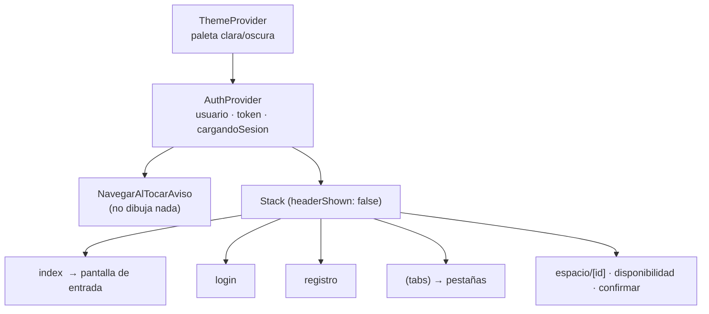
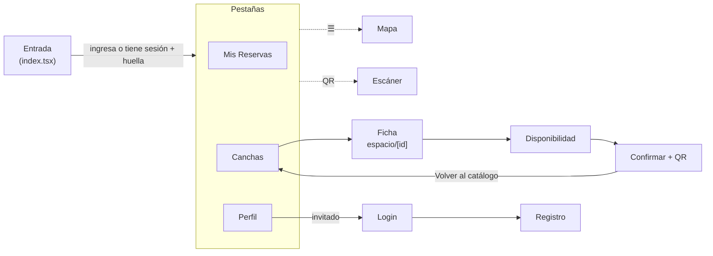

# 04 · La app móvil (`my-app/`)

Este es el trabajo propio del grupo. El documento va de lo general (arranque, navegación,
estado) a lo particular (pantalla por pantalla y función por función). Las rutas de archivo son
relativas a `my-app/src/`.

## 1. Arranque y composición de la app

`package.json` declara `"main": "expo-router/entry"`: Expo Router recorre `src/app/` y arma las
rutas a partir de los archivos. El árbol de componentes raíz (`app/_layout.tsx`) es:

- **`ThemeProvider`** y **`AuthProvider`** son los dos contextos globales. Todo lo demás es
  estado local de cada pantalla (`useState`).
- `app.json` activa `typedRoutes` (las rutas se chequean al compilar) y `reactCompiler`.
- `scheme: "reservasvillaguay"` define el esquema de enlaces profundos.
- **Identidad y permisos** (`app.json`): `name` "Deportes Villaguay", `slug`
  `reservas-deportivas-villaguay`, `android.package` e `ios.bundleIdentifier`
  `com.villaguay.reservasdeportivas`. Los plugins `expo-camera`, `expo-location`,
  `expo-image-picker` y `expo-local-authentication` fijan los textos de permiso de iOS en
  castellano (`NSCameraUsageDescription`, `NSLocationWhenInUseUsageDescription`,
  `NSPhotoLibraryUsageDescription`, `NSFaceIDUsageDescription`); sin ellos un build de iOS no
  los incluye y la app se cierra al pedir el permiso (en Expo Go no se nota). Se piden sólo los
  permisos necesarios: sin micrófono (`RECORD_AUDIO` bloqueado) ni ubicación en segundo plano.

### 1.1 Navegación

| Ruta | Archivo | Tipo | Se llega desde |
|---|---|---|---|
| `/` (entrada) | `app/index.tsx` | Pantalla raíz del Stack | Arranque de la app |
| `/login` | `app/login.tsx` | Stack | Botón "Iniciar sesión" del perfil de invitado; tras cerrar sesión |
| `/registro` | `app/registro.tsx` | Stack | Enlace desde `login` |
| `/(tabs)` → Mis Reservas | `app/(tabs)/index.tsx` | Pestaña 1 | Tras ingresar; toque de un aviso de reserva cancelada |
| `/(tabs)/espacios` | `app/(tabs)/espacios.tsx` | Pestaña 2 | Tras login/registro; "Volver al catálogo" |
| `/(tabs)/perfil` | `app/(tabs)/perfil.tsx` | Pestaña 3 | Barra inferior |
| `/mapa` | `app/(tabs)/mapa.tsx` | Pestaña **oculta** (`href: null`) | Menú ☰ de la cabecera |
| `/agenda` | `app/(tabs)/agenda.tsx` | Pestaña **oculta** | Menú ☰ (sólo encargado/administrador) |
| `/escaner` | `app/(tabs)/escaner.tsx` | Pestaña **oculta** | Ícono QR de la cabecera (sólo se muestra a encargados y administradores) |
| `/espacio/[id]` | `app/espacio/[id].tsx` | Stack | Tarjeta del catálogo; toque de un aviso "Se liberó un turno" |
| `/espacio/disponibilidad` | `app/espacio/disponibilidad.tsx` | Stack | Botón "Ver disponibilidad" de la ficha |
| `/espacio/confirmar` | `app/espacio/confirmar.tsx` | Stack | Toque de un turno libre |

> **Trampa conocida:** `app/index.tsx` y `app/(tabs)/index.tsx` resuelven ambas a la URL `/`
> (los grupos `(...)` no cuentan en la URL). El código siempre navega al grupo con
> `router.replace('/(tabs)')`; nunca hay que navegar a `'/'` esperando llegar a las pestañas.

### 1.2 Flujo de pantallas

## 2. Estado global

### 2.1 `contexto/AuthContext.tsx`

Contrato expuesto por `useAuth()`:

| Campo | Tipo | Significado |
|---|---|---|
| `usuario` | `Usuario \| null` | Datos del usuario logueado (tipo del PRD) |
| `token` | `string \| null` | JWT de la API |
| `cargandoSesion` | `boolean` | `true` hasta terminar de leer la sesión guardada |
| `login(email, contrasena)` | `Promise<void>` | Llama a la API, guarda sesión, registra el teléfono para push |
| `registro(nombre, email, telefono, contrasena)` | `Promise<void>` | Igual, creando la cuenta |
| `logout()` | `Promise<void>` | Da de baja el teléfono, borra la sesión y va a `/login` |

Funcionamiento:

1. Al montar, `cargarSesionGuardada()` lee `tokenReserva` y `usuarioReserva` de `SecureStore`;
   si ambos existen, los carga en estado y llama a `registrarParaPush()` (sin `await`).
   `cargandoSesion` pasa a `false` en un `finally`.
2. `login`/`registro` llaman a `servicios/auth.ts`, guardan token y usuario en estado **y** en
   `SecureStore`, y disparan `registrarParaPush()` sin esperar (no demora el ingreso).
3. `logout` ejecuta **en este orden**: `darDeBajaPush()` (necesita el token vigente) → limpia
   la sesión (`limpiarSesion`: estado, recordatorios locales programados y las dos claves de
   `SecureStore`) → `router.replace('/login')`.
4. `useAuth()` lanza un error si se usa fuera del `AuthProvider`.
5. **Sesión vencida:** el provider se anota en `servicios/errores.ts`
   (`registrarAlSesionVencida`). Cuando cualquier pedido recibe `NO_AUTENTICADO` de la API
   (el token dura 30 días), se ejecuta `sesionVencida()`: limpia la sesión, muestra "Tu sesión
   venció" y va a `/login`. Un `useRef` (`cerrandoSesion`) evita que se dispare dos veces a la
   vez (varios pedidos fallando juntos) o mientras corre un `logout`.

### 2.2 `providers/ThemeProvider.tsx` + `hooks/use-theme.ts`

- Dos paletas (`paletaClara`, `paletaOscura`) con claves `background, surface, text, muted,
  border, accent`.
- `modoManual`: `'sistema' | 'claro' | 'oscuro'`. `esOscuro` se deriva de `useColorScheme()` del
  sistema cuando el modo es `'sistema'`.
- `useTema()` devuelve `{ paleta, esOscuro, modoManual, cambiarTema }`. Todas las pantallas
  pintan con `paleta.*` en línea (`style={[estilos.x, { color: paleta.text }]}`).
- **No persiste** la elección: al cerrar la app vuelve a `'sistema'`.
- `ThemeContext` está tipado `any` (sin tipo estricto).

## 3. Capa de servicios

### 3.1 `servicios/auth.ts`

| Función | Pedido | Notas |
|---|---|---|
| `BASE_URL` | — | Es `API_URL` de `config.ts` (reexportada: la usa `notificaciones.ts`) |
| `iniciarSesionApi(email, contrasena)` | `POST /auth/ingreso` | Devuelve `datos` (`{ token, usuario }`). Si falla, lanza un `ErrorDeApi` con el mensaje de la API ("El email o la contraseña no son correctos.") |
| `registrarUsuarioApi(nombre, email, telefono, contrasena)` | `POST /auth/registro` | Si falla, lanza con el mensaje de la API (p. ej. `EMAIL_YA_REGISTRADO`) |
| `actualizarPerfilApi({ nombre?, telefono? })` | `PATCH /yo` | Exige token (`SIN_SESION` si no hay); devuelve el `Usuario` actualizado |
| `registrarDispositivoApi(tokenExpo, plataforma)` | `POST /dispositivos` | Sin sesión no hace nada; si la API responde mal, lanza `ErrorDeApi` |
| `darDeBajaDispositivoApi(tokenExpo)` | `DELETE /dispositivos/:token` | `encodeURIComponent` porque el token lleva corchetes |

Todas las funciones de este archivo reportan errores con `lanzarSiError` (ver §3.5). Salvo las de dispositivos, empiezan con `verificarConexion()` (abajo).

### 3.2 `servicios/reservas.ts`

La URL base es `API_URL` (de `config.ts`). `verificarConexion()` usa
`Network.getNetworkStateAsync()` y lanza `'Sin conexión a internet o red local.'` si
`isConnected` es falso. `tokenObligatorio()` lee `tokenReserva` de `SecureStore` y, si no hay,
lanza `errorSinSesion()` (código `SIN_SESION`).

| Función | Pedido | Comportamiento ante error |
|---|---|---|
| `obtenerEspacios()` | `GET /espacios` | Guarda el resultado en SQLite; ante cualquier fallo devuelve lo último guardado (o `[]`) |
| `obtenerEspacioPorId(id)` | `GET /espacios/:id` | Ante un fallo busca el espacio en lo guardado; si no está, `null` |
| `obtenerDeportes()` | `GET /deportes` | Igual que los espacios: respaldo local ante cualquier fallo |
| `obtenerTurnosEspacio(espacioId, fecha?)` | `GET /espacios/:id/turnos?fecha=` | Lanza `ErrorDeApi` (la usa la grilla) |
| `crearReserva(turnoId, cantidadPersonas)` | `POST /reservas` + Bearer | Lanza `ErrorDeApi` con el mensaje de la API; `SIN_SESION` si no hay token |
| `cancelarReserva(reservaId)` | `POST /reservas/:id/cancelacion` | Lanza `ErrorDeApi` |
| `obtenerMisReservas(cuando)` | `GET /yo/reservas?cuando=proximas\|pasadas` | Lanza `ErrorDeApi` |
| `obtenerMisFavoritos()` | `GET /yo` (campo `espaciosFavoritos`) + `GET /espacios` | Sin sesión o con error devuelve `[]` |
| `alternarFavoritoApi(espacioId, marcar)` | `PUT` / `DELETE /yo/espacios-favoritos/:id` | Lanza `ErrorDeApi` |
| `obtenerReservasDelDia(fecha)` | `GET /reservas?fecha=&pagina=&porPagina=100` + Bearer | (personal) Recorre las páginas hasta juntar todas; lanza `ErrorDeApi` |
| `marcarAusenteApi(reservaId)` | `POST /reservas/:id/ausente` + Bearer | (personal) Devuelve la reserva ya `ausente`; lanza `ErrorDeApi` |
| `obtenerUsuarioApi(usuarioId)` | `GET /usuarios/:id` + Bearer | (personal) Devuelve el usuario con su teléfono; lanza `ErrorDeApi` |
| `registrarIngresoApi(codigoQr, espacioId)` | `POST /ingresos` + Bearer | Lanza `ErrorDeApi` con el mensaje de la API; devuelve la `Reserva` ya `cumplida` |

Detalles de implementación que conviene saber explicar:

- **Desempaquetado:** la API envuelve todo en `{ datos }`; cada función devuelve `json.datos`.
- **`obtenerMisFavoritos`:** pide `/yo`, toma `espaciosFavoritos` (ids) y los cruza con el
  catálogo (`obtenerEspacios()`) para devolver las tarjetas completas.
- **Funciones simuladas:** ya no quedan. `registrarIngresoApi` era una simulación y ahora llama
  a la API; se eliminaron `obtenerComplejosApi`, `obtenerMisReservasApi` (datos falsos sin uso)
  y `obtenerTurnosPorDia` / `obtenerReservasFijas` (duplicada la primera; la segunda es un
  endpoint de personal).
- **Catálogo sin conexión:** cada vez que `obtenerEspacios()` y `obtenerDeportes()` descargan
  bien, dejan la lista **completa** en SQLite (`servicios/db.ts`, base `villaguay_deportes.db`).
  Si no hay red o la API no responde, devuelven esa copia. Así se pueden ver el catálogo, los
  filtros, la ficha y el mapa de los complejos sin conexión (las fotos de las tarjetas del
  listado sí necesitan red; la foto y el video de la ficha se guardan aparte, ver §4.4).
- **Qué se traga y qué se lanza:** las funciones del catálogo (`obtenerEspacios`,
  `obtenerEspacioPorId`, `obtenerMisFavoritos`) devuelven un valor de respaldo ante cualquier
  fallo para no romper la pantalla; las acciones del usuario (reservar, cancelar, favoritos, ingreso)
  lanzan el error para que la pantalla muestre el mensaje.

### 3.3 `servicios/notificaciones.ts`

Detallado en [05](05-notificaciones-push.md). Resumen: al importarse registra
`setNotificationHandler` (mostrar banner/lista/sonido con la app abierta); `registrarParaPush()`
pide permiso, obtiene el token de Expo y lo anota en la API; `darDeBajaPush()` lo da de baja.
Además maneja el **recordatorio local de 2 horas**: `programarRecordatorio`,
`cancelarRecordatorio`, `cancelarTodosLosRecordatorios` y `sincronizarRecordatorios`.

### 3.4 `servicios/db.ts`

Persistencia local del **catálogo**: `guardarEspaciosEnTelefono` / `leerEspaciosDelTelefono` y
`guardarDeportesEnTelefono` / `leerDeportesDelTelefono` (SQLite, base `villaguay_deportes.db`).
La base se abre y sus tablas (`espacios_locales`, `deportes_locales`, `reservas_locales`) se
crean la **primera vez que se usa**, no al importar el archivo. Guardar reemplaza la lista
completa dentro de una transacción (`withTransactionSync`), de modo que un espacio dado de baja
en el servidor tampoco queda en el teléfono. Las funciones de `reservas_locales` y
`guardarPreferenciaComplejo` (kv-store) existen pero ninguna pantalla las usa: "Mis reservas"
tiene su propia base (`mis_reservas_final.db`).

### 3.5 `servicios/errores.ts`

Un único lugar donde se interpretan los errores de la API. Toda respuesta de error tiene la
forma `{ error: { codigo, mensaje } }`: el `codigo` es estable (se compara) y el `mensaje` está
listo para mostrarse.

| Elemento | Qué hace |
|---|---|
| `ErrorDeApi` | `Error` con `codigo` (de la API, o `SIN_SESION` si nace en la app) y `estado` HTTP |
| `lanzarSiError(respuesta, porDefecto)` | Si la respuesta no es OK, lanza un `ErrorDeApi` con el `mensaje` de la API (o `porDefecto` si no se puede leer) |
| `errorDesdeRespuesta` | Lo mismo pero devolviendo el error (lo usa `lanzarSiError`); si el código es `NO_AUTENTICADO` avisa a `registrarAlSesionVencida` |
| `errorSinSesion()` | `ErrorDeApi` con código `SIN_SESION` para cuando falta el token local |
| `codigoDe(error)` / `mensajeDe(error, porDefecto)` | Las pantallas los usan en el `catch` para decidir qué hacer y qué texto mostrar |
| `registrarAlSesionVencida(fn)` | El `AuthContext` se anota para cerrar la sesión cuando vence el token |

Diferencia entre los dos códigos de "sin sesión": `SIN_SESION` es del cliente (no hay token
guardado: se ofrece ir a ingresar); `NO_AUTENTICADO` es de la API (el token existe pero no sirve:
la sesión se cierra sola y se vuelve al ingreso).

### 3.6 `servicios/config.ts`

Exporta `API_URL`: `process.env.EXPO_PUBLIC_API_URL` (sin barra final) o, si no está definida,
`http://192.168.1.6:3000`. Todos los servicios la usan. Expo incorpora las variables
`EXPO_PUBLIC_*` al iniciar, por eso hay que reiniciar con `npx expo start -c` al cambiarla. El
archivo `my-app/.env.example` muestra el formato; cada integrante crea su `.env.local`
(ignorado por git).

### 3.7 `servicios/turnos.ts`

`leerTurnoId(turnoId)` desarma el id `tur-<espacioId>-<AAAAMMDD>-<HH>` con una expresión
regular (sirve aunque el id del espacio tenga guiones: `esp-02`) y devuelve
`{ espacioId, fecha: 'AAAA-MM-DD', hora: 'HH:00', inicio: Date }`, o `null` si el formato no
es válido. `inicio` se construye con el desfase fijo `-03:00` (Argentina no tiene horario de
verano), así que no depende de la zona horaria del teléfono. Lo usan "Mis reservas"
(`formatearTurno`), el recordatorio local y la agenda.

También exporta dos helpers de fechas: `aFechaLocal(Date)` (AAAA-MM-DD con la fecha **local**; no usa
`toISOString()`, que da la fecha en UTC) y `desplazarDia('AAAA-MM-DD', n)` (suma o resta días, calculando
a mediodía para evitar saltos por cambios de horario). Los usan la grilla de disponibilidad y la agenda.

### 3.8 `servicios/archivos.ts`

Copias locales de fotos y videos con la API **nueva** de `expo-file-system` (`File`, `Paths`).
`nombreDeCache(prefijo, url)` arma el nombre del archivo con un hash (djb2) de la **ruta** de la
URL, sin el servidor: la IP de la API cambia de red en red y no debe invalidar lo guardado.
`archivoGuardado(nombre)` devuelve la URI local si el archivo existe (sin red) y
`guardarArchivo(url, nombre)` lo descarga con `File.downloadFileAsync`; si falla, borra el
archivo incompleto (en Android una descarga cortada puede dejarlo) y devuelve `null`.

## 4. Pantallas, una por una

### 4.1 Entrada — `app/index.tsx` (`LoginScreen`)

Pantalla "Bienvenido". Usa `AuthContext` como el resto de la app.

- **Estado:** `email`, `password` (arrancan vacíos), `cargando`, y un
  `useRef` `biometriaPedida` que evita pedir la huella dos veces.
- **Con sesión guardada:** un `useEffect` espera `cargandoSesion === false`; si hay `token` y no
  se pidió la huella, llama a `verificarSesion()`. Esta consulta
  `LocalAuthentication.hasHardwareAsync()` e `isEnrolledAsync()`: si el teléfono tiene huella/PIN
  enrolado, pide `authenticateAsync` ("Ingresá a tus reservas") y, si tiene éxito, hace
  `router.replace('/(tabs)')`; si falla muestra "Acceso denegado". Si no hay biometría, entra
  directo.
- **`iniciarSesion()`:** valida que haya datos; vibra (`Haptics.impactAsync(Heavy)`); marca
  `biometriaPedida = true` (no pedir huella tras escribir la contraseña); `await login(...)` y
  `router.replace('/(tabs)')`. Un error se muestra con `Alert`.

### 4.2 `app/login.tsx` y `app/registro.tsx`

- **Login:** formulario email/contraseña (controlados con `useState`); `login()` y luego
  `router.replace('/(tabs)/espacios')`. Botón ✕ para volver. Enlace a registro.
- **Registro:** nombre, email, teléfono (obligatorio en este proyecto), contraseña; llama a
  `registro()` y navega a `/(tabs)/espacios`. Valida sólo que no haya campos vacíos (la API
  valida el resto).

### 4.3 Catálogo — `(tabs)/espacios.tsx`

- **Carga:** `useEffect` → `Promise.all([obtenerEspacios(), obtenerDeportes()])`; `cargando`
  controla un `ActivityIndicator`.
- **Filtros (en el cliente):** `deporteFiltro` y `complejoFiltro` (`string | null`). Los
  complejos se derivan con `new Set(espacios.map(e => e.complejo))`. `espaciosFiltrados` aplica
  ambos con `&&`. Los botones se dibujan con `renderFiltroBoton`.
- **Lista:** `FlatList` con tarjetas (`renderEspacio`): imagen, nombre, precio `$X/h`,
  complejo, superficie y la etiqueta "Luz nocturna" si `iluminacion`. Al tocar:
  `router.push({ pathname: '/espacio/[id]', params: { id } })`.
- **Observación:** el filtrado se hace en la app, aunque la API soporta `?deporteId=&complejo=`.
- **Sin conexión:** `obtenerEspacios()` y `obtenerDeportes()` devuelven la última copia guardada
  (ver §3.2), así que la lista y los filtros siguen funcionando.

### 4.4 Ficha — `espacio/[id].tsx` (`FichaEspacioScreen`)

La pantalla más compleja. Lee el `id` con `useLocalSearchParams`.

| Bloque | Cómo funciona |
|---|---|
| Carga | `useFocusEffect` → `cargarDetalle()`: `obtenerEspacioPorId`, luego `obtenerMisFavoritos` para saber si el corazón va lleno |
| Favorito | `manejarFavorito()`: **actualización optimista** (cambia el estado y llama a `alternarFavoritoApi`; si falla, revierte y muestra `Alert`) |
| Galería comunitaria | SQLite propia `canchas_galeria.db`, tabla `galeria(espacioId PK, fotos_json)`. `useEffect` abre/crea la base (`dbLista`); `cargarGaleriaLocal()` lee y normaliza (string → `{uri, tipo:'image'}`) |
| "Reportar" | `reportarEstado()`: pide permiso de galería (`ImagePicker.requestMediaLibraryPermissionsAsync`), abre el selector (imágenes o videos, calidad 0,7), antepone el archivo a la lista y la guarda como JSON con `INSERT OR REPLACE`. Muestra "¡Reporte subido!" |
| Video | `ReproductorCancha` usa `useVideoPlayer` + `VideoView` (`loop`). `ReproductorMini` (silenciado) para videos de la galería |
| Caché de medios | Si la foto principal y el video ya están guardados en el teléfono (`servicios/archivos.ts`) los usa enseguida, también sin conexión; los que faltan se descargan **en segundo plano** y, al terminar, la pantalla pasa a usar la copia local (el video muestra "Guardado offline") |
| CTA | Botón fijo "Ver disponibilidad" → `/espacio/disponibilidad?id=` |

Puntos para tener claros:

- La galería "de la comunidad" es **local a cada teléfono**: no se sube a la API ni la ven otros
  usuarios, aunque el mensaje diga "reporte subido". La API tiene `POST /archivos` para esto.
- La caché de medios usa la API nueva de `expo-file-system` (`File`, `Paths`). El nombre del
  archivo lleva un hash de la ruta de la URL: si la foto o el video cambian en el servidor, se
  guardan de nuevo. La descarga **no demora la pantalla** (antes se esperaba a que terminara).
  Los archivos quedan en el directorio de documentos del teléfono y no se borran solos.
- La conexión SQLite está en una variable de módulo (`let db`) para no abrirla en cada render.

### 4.5 Disponibilidad — `espacio/disponibilidad.tsx`

- **`generarProximosDias()`:** arma 7 objetos `{ iso, nombre, numero }` (el primero es "Hoy").
  El `iso` sale de `aFechaLocal()`, que arma `AAAA-MM-DD` con la fecha **local** del teléfono
  (`getFullYear/getMonth/getDate`, helper `aFechaLocal` de `servicios/turnos.ts`). No se usa `toISOString()` porque devuelve la fecha en UTC y
  en Argentina (UTC−3), entre las 21:00 y las 24:00, UTC ya es el día siguiente.
- **Estado:** `fechaSeleccionada` (por defecto hoy), `turnosReales` (`any[]`), `cargando`.
- **Carga:** `useFocusEffect` con una bandera `estaActivo` para ignorar respuestas tardías
  si la pantalla perdió el foco o cambió el día (evita condiciones de carrera). Llama a
  `obtenerTurnosEspacio(id, fechaSeleccionada)`.
- **`calcularEstadoVisual(turno)`:** si el día es anterior a hoy → `'pasado'`; si es hoy y
  `horaTurno <= horaActual` → `'pasado'`; si no, usa `turno.estado`. Sólo mira la **hora**
  (no los minutos): un turno de las 14:00 pasa a "Finalizado" apenas son las 14:00.
- **`renderBotonEstado(estado)`:** `libre` → verde "Disponible"; `reservado` y `fijo` →
  "Ocupado" (la app **no distingue** una fija de una reserva); `mantenimiento` → ámbar;
  `pasado` → "Finalizado".
- **Interacción:** sólo los turnos `libre` son tocables (`disabled={estadoVisual !== 'libre'}`);
  navega a `confirmar` con `{ id, fecha, hora, turnoId }`.
- No muestra el `motivoBloqueo` ni el precio del turno (la API los envía).

### 4.6 Confirmación — `espacio/confirmar.tsx`

- Recibe `id, fecha, hora, turnoId` por parámetros de ruta; carga el espacio.
- **Cantidad de personas:** un selector (− / +) de 1 a `espacio.capacidad`; arranca en la
  capacidad (`setPersonas(data.capacidad)` al cargar el espacio) y se puede bajar.
- **`confirmarReservaApi()`:** `procesando = true` (deshabilita el botón),
  `crearReserva(turnoId, personas)`, guarda `reservaGenerada.codigoQr` en `qrData` y
  `confirmado = true`. Errores, según `codigoDe(error)`:
  - `SIN_SESION` → "Falta iniciar sesión" con el botón **Ingresar** (lleva a `/login`);
  - `NO_AUTENTICADO` → no muestra nada (el `AuthContext` ya avisó "Sesión vencida");
  - `TURNO_OCUPADO` / `TURNO_NO_DISPONIBLE` / `TURNO_PASADO` → alerta con el mensaje de la API
    y el botón **Ver otros turnos** (`router.back()`; la grilla se recarga sola al ganar el foco);
  - cualquier otro → alerta "No se pudo reservar" con el mensaje de la API.
- **Vista de éxito:** ícono de check, texto "Te esperamos el {fecha} a las {hora}…" y el QR
  dibujado con `react-native-qrcode-svg` (`<QRCode value={qrData} size={150} />`). Botón
  "Volver al catálogo" (`router.navigate('/(tabs)/espacios')`).
- Muestra "Precio del turno: $X" y aclara que el pago es en el complejo (la app no cobra).
- Tras reservar llama a `programarRecordatorio(reserva, espacio.nombre)` (sin esperar): el
  teléfono avisará 2 horas antes del turno.

### 4.7 Mis Reservas — `(tabs)/index.tsx`

Pantalla clave del requisito offline.

1. **Filtro** `proximas | historial` (`pasadas` en la API) con dos botones.
2. **`cargarMisReservas()`** (se ejecuta con `useFocusEffect` cada vez que la pestaña gana el
   foco, o cambia `filtro`/`usuario`). Sin `usuario`, no consulta.
3. **Con conexión** (`isConnected && isInternetReachable`): `Promise.all` de
   `obtenerMisReservas(filtro)` y `obtenerEspacios()`; arma un mapa `{ [espacioId]: Espacio }`
   y lo **guarda en SQLite**: base `mis_reservas_final.db`, tabla
   `cache_reservas(filtro PK, reservas_json, espacios_json)`, con `INSERT OR REPLACE`.
   Usa las variantes **síncronas** (`openDatabaseSync`, `execSync`, `runSync`) "para evitar
   crasheos en Android".
4. **Sin conexión:** cartel "⚠️ Sin conexión. Mostrando reservas guardadas." y lectura de la
   fila del filtro actual. Primera vez sin caché → lista vacía.
5. **Tarjeta de reserva:** estilo "wireframe" del PRD. Título "Mi reserva – ESTADO", nombre de la
   cancha, fecha/hora, complejo, precio ("se paga en el lugar"), **código QR** (si no está
   cancelada) y botones "Cómo llegar" y "Cancelar reserva".
6. **`formatearTurno(turnoId)`:** usa `leerTurnoId` (`servicios/turnos.ts`) para obtener la
   fecha y la hora del id `tur-esp-02-20260919-19`. Sigue dependiendo del formato D1, pero el
   desarmado está en un solo lugar. `horaFin` = hora + 1.
7. **Cómo llegar:** `Linking.openURL` a una búsqueda de Google Maps del complejo + ", Villaguay".
8. **Cancelar:** `Alert` de confirmación → `cancelarReserva(id)` → recarga. El botón sólo se
   ve en "próximas" y **con conexión**. `plazoDeCancelacion(cancelableHasta)` calcula el aviso
   desde el dato que entrega la API: "Se puede cancelar sin aviso hasta las 15:00 de hoy" (o
   "del 19/09" si es otro día). Si el plazo ya pasó, **oculta el botón** y muestra "Ya pasó el
   plazo para cancelar. Avisale al encargado.".
9. **Recordatorios:** al cargar las reservas "próximas" con conexión se llama a
   `sincronizarRecordatorios(reservas, espacios)`, que programa el aviso de 2 horas de cada
   reserva confirmada y cancela el de las que ya no lo están (por ejemplo, las que canceló un
   bloqueo del encargado). Al cancelar una reserva desde la app se llama a `cancelarRecordatorio`.

### 4.8 Escáner — `(tabs)/escaner.tsx`

1. **Control de rol:** `esPersonal = usuario?.rol === 'encargado' || 'administrador'`. Si no lo
   es, la pantalla muestra "El control de ingresos es sólo para el personal del complejo" y no
   inicia nada (el ícono QR de la cabecera tampoco se muestra). La API igualmente rechaza el
   pedido con `SIN_PERMISO`.
2. **`inicializarEscaner()`:** si hay huella/PIN, exige `authenticateAsync`; luego carga los
   espacios para que el encargado elija **qué cancha controla**.
3. **Permiso de cámara** con `useCameraPermissions()`; si no está concedido, muestra una
   pantalla explicativa con "Otorgar permiso".
4. **`CameraView`** a pantalla completa, sólo `qr` (`barcodeTypes: ["qr"]`).
   `onBarcodeScanned` se desactiva mientras `escaneando` es `true` (evita lecturas repetidas).
5. **`manejarEscaneo({ data })`:** llama a `registrarIngresoApi(data, espacioSeleccionado)`, que
   hace `POST /ingresos`. Éxito → `Haptics.notificationAsync(Success)` + "¡Ingreso autorizado!"
   con la cantidad de personas de la reserva. Error → `Haptics.notificationAsync(Error)` +
   "Ingreso rechazado" con **el mensaje de la API** ("Esa reserva no es para hoy.", "Esa
   reserva es para otra cancha.", "Esa reserva ya ingresó.", etc.).

### 4.9 Mapa — `(tabs)/mapa.tsx`

Mapa **nativo** con `react-native-maps` (`MapView` + `Marker`), sin `WebView`: en Android usa
Google Maps y en iPhone Apple Maps.

- **Datos:** `cargarDatos()` agrupa los espacios por `complejo`, tomando las `coordenadas` del
  primer espacio de cada uno (`Record<string, Complejo>` con `latitud`, `longitud` y la lista de
  `canchas`). Sólo cuenta los espacios que tienen coordenadas.
- **Vista inicial:** `REGION_VILLAGUAY`. Cuando el mapa avisa que está listo (`onMapReady`) y hay
  complejos, un `useEffect` los encuadra a todos con `fitToCoordinates` (con un solo complejo usa
  `animateToRegion`).
- **Marcadores:** un `Marker` por complejo. Al tocarlo se abre una **tarjeta** inferior con el
  nombre, la cantidad de canchas, sus nombres y el botón **Cómo llegar**, que abre Google Maps
  con la ruta hasta las coordenadas (`https://www.google.com/maps/dir/?api=1&destination=lat,lng`).
  La tarjeta se cierra con la ✕.
- **Ubicación:** `Location.requestForegroundPermissionsAsync()` → `getCurrentPositionAsync`. Si se
  concede, `showsUserLocation` dibuja el punto del usuario, la tarjeta muestra la distancia
  (fórmula de Haversine en `distanciaEnKm`) y el marcador del **complejo más cercano** va en verde
  (`masCercanoId`, con `useMemo`): cumple el "saber qué complejo tiene más cerca" del PRD. Si se
  niega el permiso, el mapa funciona igual sin esos datos (requisito del PRD).
- **Tema:** `userInterfaceStyle` sigue el modo claro/oscuro (lo aplica iOS; en Android el mapa
  de Google queda con su estilo claro).
- **Sin datos:** si no hay complejos (sin conexión y sin catálogo guardado) muestra un aviso.
- **Configuración nativa:** en Android los builds necesitan una clave de Google Maps
  (`GOOGLE_MAPS_API_KEY`, que `app.config.js` agrega al manifiesto; ver el
  [README §5.4](../README.md)); en Expo Go y en iPhone no.
- **Sin conexión:** la lista de complejos sale del catálogo guardado (§3.2), pero los mosaicos del
  mapa se descargan de Google/Apple: sin red el fondo del mapa puede no verse completo.

### 4.10 Perfil — `(tabs)/perfil.tsx`

- **Invitado** (`usuario` nulo): texto explicativo y botón "Iniciar sesión" → `/login`.
- **Con sesión:** nombre, email, teléfono, rol, tarjetas de **Ausencias** y **Cancelaciones
  tardías** (cumple "quiero saberlo" del PRD), botón **Editar** (modal con nombre y teléfono) y
  **Salir**.
- **`guardarCambios()`:** valida no vacíos → `actualizarPerfilApi` → actualiza la vista y
  `SecureStore.usuarioReserva`. (No actualiza el `usuario` del `AuthContext`; la vista usa
  `usuarioVisual` local.)
- **Selector de tema** "Apariencia": Sistema / Claro / Oscuro (`cambiarTema`).
- **Salir:** `Alert` de confirmación → `logout()` → `router.replace('/login')`.

### 4.11 `(tabs)/_layout.tsx` — barra de pestañas y menú

- `Tabs` con tres pestañas visibles (Mis Reservas, Canchas, Perfil) y dos ocultas
  (`href: null`): `escaner`, `mapa` y `agenda`.
- Cabecera común: título "Deportes Villaguay", ícono ☰ a la izquierda (abre un `Modal` con la
  opciones "Mapa de Complejos" y, sólo para el personal, "Agenda del día") e ícono QR a la derecha (→ `/escaner`), que **sólo aparece si el
  usuario es encargado o administrador** (`headerRight` es `undefined` para el resto).
- Los colores de barra y cabecera salen de `paleta`.

### 4.12 Agenda del día — `(tabs)/agenda.tsx` (personal)

Pantalla del encargado y del administrador para ver las reservas de un día y marcar a quien no se
presentó (PRD §4). Se abre desde el menú ☰ (la opción sólo aparece al personal). Como el escáner,
muestra "sólo para el personal" a otros roles (`esPersonal`); la API además responde 403.

- **Selector de día:** ‹ y › (con `desplazarDia`); tocar el título vuelve a hoy. La etiqueta dice
  "Hoy 19/09", "Ayer", "Mañana" o el día de la semana.
- **Carga (`cargar(dia)`):** `Promise.all` de `obtenerReservasDelDia(dia)` y `obtenerEspacios()`
  (para mostrar el nombre de la cancha). Descarta las `cancelada`, ordena por hora de inicio y
  guarda un mapa id → nombre. Un contador `pedidoActual` (`useRef`) descarta las respuestas que
  llegan tarde si el usuario ya cambió de día. Se recarga al abrir (`useFocusEffect`) y con
  *pull to refresh*. Los errores se muestran con el mensaje de la API y un botón **Reintentar**.
- **Resumen:** "N por llegar · N ingresaron · N ausentes".
- **Tarjeta de reserva:** hora (`19:00 – 20:00`), cancha, cantidad de personas y un chip de estado
  (Reservada / Ingresó HH:MM / No se presentó).
- **Contacto:** el botón **Ver contacto** pide `GET /usuarios/:id` y muestra nombre y teléfono con
  el botón **Llamar** (`tel:`); lo pedido queda guardado en el estado para no repetir el pedido.
- **No se presentó:** sólo en reservas `confirmada`. Se habilita cuando
  `inicio + 15 min <= ahora` (regla D10, calculada con `leerTurnoId`); antes está atenuado y dice
  "Se puede marcar desde las HH:MM". Pide confirmación (`Alert`), llama a `marcarAusenteApi` y
  reemplaza la reserva en la lista. Si falla (por ejemplo, ya había ingresado), muestra el mensaje
  de la API y recarga. El servidor vuelve a validar la regla (`ANTES_DE_TIEMPO`), suma 1 a las
  `ausencias` del jugador y es idempotente.

> La habilitación de la pantalla usa el reloj del teléfono; la API usa el suyo. Si se prueba la
> API con `RELOJ_FIJO`, los dos relojes pueden no coincidir.

## 5. Convenciones del código de la app

| Tema | Convención |
|---|---|
| Idioma | Identificadores y textos en castellano (`obtenerEspacios`, `paleta`, `estilos`) |
| Estilos | `StyleSheet.create` al final del archivo (`const estilos = …`) + colores del tema en línea |
| Íconos | `Ionicons` de `@react-native-vector-icons/ionicons` |
| Seguridad de pantalla | `SafeAreaView` de `react-native-safe-area-context` con `edges` |
| Datos | Tipos del PRD en `tipos/`; muchos `any` en pantallas (`useState<any[]>`, `catch (error: any)`) |
| Efectos | `useFocusEffect` para recargar al volver a una pantalla; bandera `estaActivo` contra respuestas tardías |
| Errores al usuario | `Alert.alert(titulo, mensaje)` |
| Claves de almacenamiento | `tokenReserva`, `usuarioReserva`, `tokenPushExpo` (SecureStore); `mis_reservas_final.db`, `canchas_galeria.db` (SQLite) |

## 6. Permisos y capacidades nativas

| Capacidad | Permiso que se pide | Cuándo | Si se deniega |
|---|---|---|---|
| Cámara | Cámara | Al abrir el escáner | Pantalla explicativa con botón de reintento |
| Galería | Biblioteca de medios | Al tocar "Reportar" / "Abrir galería" | `Alert` "Permiso denegado" |
| Ubicación | Ubicación en primer plano | Al abrir el mapa | El mapa funciona igual, sin el punto del usuario ni las distancias |
| Notificaciones | Notificaciones | Al registrar el teléfono tras ingresar | No se registra el token; la app sigue funcionando |
| Biometría | (sistema) | Al abrir con sesión guardada y en el escáner | Entrada denegada / reintentar |

## 7. Limpieza del repositorio

Se eliminó lo que no era parte de la app y hacía ruido (o impedía que `npx tsc --noEmit`
terminara sin errores):

| Qué se eliminó | Por qué |
|---|---|
| `app/layout.txt`, `app/(tabs)/mapa.txt`, `app/(tabs)/reservas.txt`, `servicios/notificaciones.txt` | Copias de respaldo de versiones anteriores (están en el historial de git) |
| `src/components/*`, `src/constants/`, `src/global.css`, `src/hooks/use-color-scheme*.ts`, `src/theme/`, `scripts/reset-project.js` y el script `reset-project` | Plantilla de `create-expo-app` sin uso; varios archivos **no compilaban** (`useTheme` inexistente, `global.css`, `.module.css`) |
| `src/hooks/useLogin.ts` | Hook de login con una URL `TU_IP_LOCAL`; lo reemplazó `AuthContext` |
| `src/app/(tabs)/estado-cancha.tsx` y su entrada en las pestañas | Pantalla huérfana: el selector de foto era un `Alert` sin función (el reporte real está en la ficha) |
| Imágenes de la plantilla (`react-logo*`, `expo-badge*`, `expo-logo`, `logo-glow`, `tutorial-web`, `tabIcons/`) | Sin referencias |
| `package.json` y `package-lock.json` de la **raíz** del repo | Sobrantes de un `npm install` hecho en la carpeta equivocada (sólo traían `axios`, `zod` y `react-hook-form`) |
| Dependencias de `my-app`: `axios`, `zod`, `react-hook-form`, `@hookform/resolvers`, `@expo/ui`, `expo-glass-effect`, `expo-status-bar`, `expo-symbols` | Ninguna se importaba |

Se conservan a propósito:

| Archivo / dependencia | Motivo |
|---|---|
| `src/mocks/datos.ts` | Es la evidencia de la fase de datos simulados que pide el PRD; ya no se importa |
| `expo-sensors` | El PRD lo lista entre las capacidades (háptica y sensores); no se usa todavía (G-07) |
| `expo-dev-client` | Lo necesita el perfil `development` de EAS |
| `expo-system-ui`, `expo-font`, `expo-image`, `expo-web-browser`, `expo-splash-screen`, `react-native-worklets` | Dependencias por defecto de Expo (algunas con plugin en `app.json`); `depcheck` las marca sin uso pero quitarlas no aporta |
| `servicios/db.ts` (funciones de `reservas_locales` y la preferencia de complejo) | Existen pero ninguna pantalla las usa; "Mis reservas" tiene su propia base |
