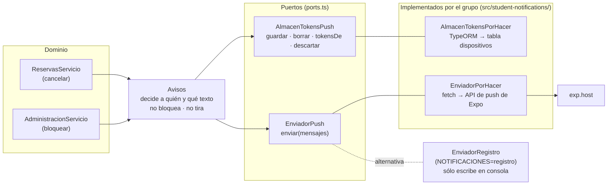
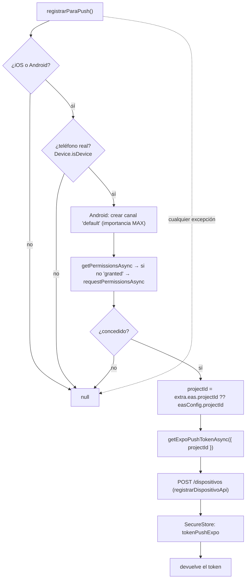
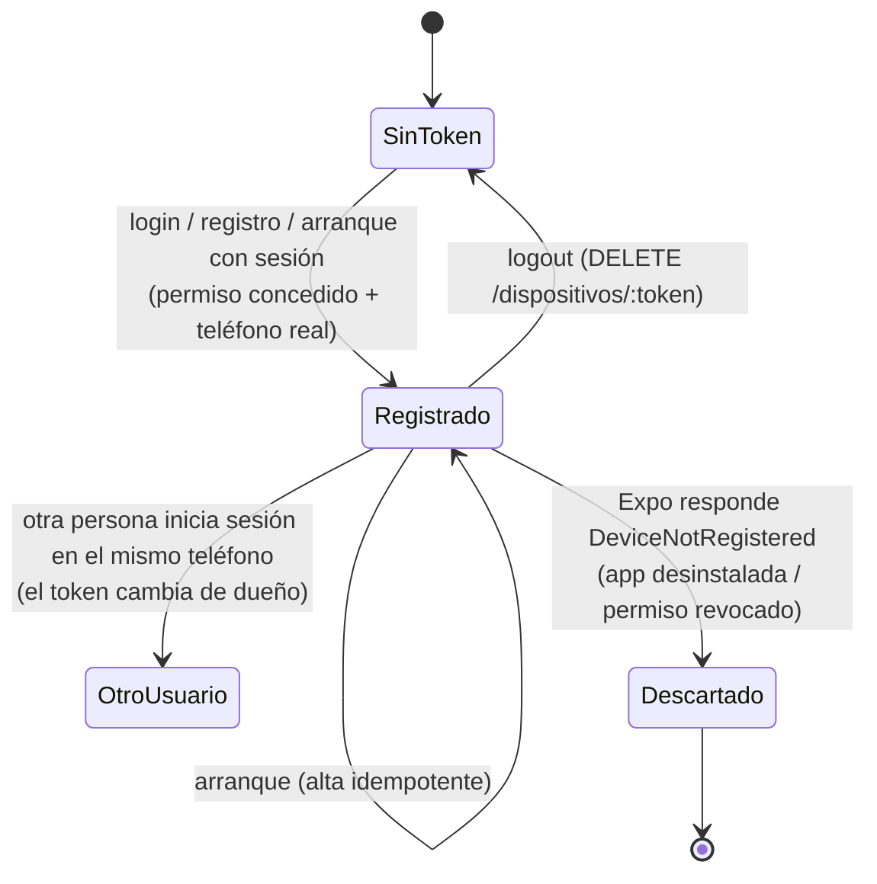

# 05 · Notificaciones push

Este es el módulo que la cátedra dejó **a completar por el grupo** (M9). La API ya decidía
*cuándo, a quién y con qué texto* avisar; faltaba (a) **guardar el token de cada teléfono** y
(b) **mandar la push** a Expo. La app, por su parte, tenía un token simulado. Este documento
explica el diseño completo, el código y cómo probarlo.

## 1. Qué hay que explicar en una frase

> *Cuando el servidor cancela una reserva (bloqueo) o se libera un turno de un espacio
> favorito, busca los teléfonos de las personas afectadas y le pide al servicio de push de Expo
> que les entregue una notificación. Para eso cada teléfono se registra con su token de Expo al
> iniciar sesión y se da de baja al cerrarla.*

## 2. Qué notificaciones existen

| # | Hecho que la dispara | Quién recibe | Título | Cuerpo (ejemplo) | `datos` | Código |
|---|---|---|---|---|---|---|
| 1 | Un bloqueo cancela una reserva confirmada | El dueño de esa reserva | `Reserva cancelada` | `Cancelamos tu reserva del 14/11 a las 21:00. Motivo: Cancha anegada.` | `{ reservaId }` | `admin.service.ts` |
| 2 | Se cancela una reserva y el turno sigue siendo futuro | Quienes tienen ese espacio como favorito, **menos quien canceló** | `Se liberó un turno` | `Cancha 2 — Fútbol 5 tiene libre el turno del 14/11 a las 21:00.` | `{ espacioId, turnoId }` | `bookings.service.ts` |
| 3 | `POST /dispositivos/prueba` | El propio usuario, en todos sus teléfonos | `Notificación de prueba` | `Si ves esto, las notificaciones andan.` | `{ tipo: 'prueba' }` | `devices.controller.ts` |
| — | **Recordatorio 2 h antes del turno** | — | — | — | — | **No implementado**: es *local* del teléfono (R22); la API no lo manda |

> El `Usuario` del PRD no tiene un interruptor de avisos (D7): se notifica siempre. Para dejar
> de recibir avisos de un espacio, se lo saca de favoritos.

## 3. Arquitectura: puertos y adaptadores

La API aplica el patrón **puertos y adaptadores** (arquitectura hexagonal). El dominio nunca
manda una push directamente: le pide a `Avisos` que avise, y `Avisos` usa dos **puertos**
(interfaces abstractas) que el grupo implementó.



El módulo (`common/notifications/notifications.module.ts`, `@Global()`) conecta puertos con
implementaciones y elige el enviador según `NOTIFICACIONES`: `expo` → `EnviadorPorHacer`;
`registro` → `EnviadorRegistro` (imprime el mensaje en la consola de la API, ideal para
desarrollar sin teléfono).

**Por qué este diseño**

- El dominio no conoce a Expo: cambiar de proveedor (FCM, OneSignal) sólo toca un adaptador.
- Los tests reemplazan el enviador por un **servidor de Expo falso** (`fake-expo-server.ts`).
- Un fallo de push **no puede romper** "bloquear turnos" ni "cancelar": `Avisos.avisar()` no
  espera el envío y captura todo error (lo loguea).

## 4. Backend: el código que escribió el grupo

### 4.1 `student-notifications/dispositivo.entity.ts`

```ts
@Entity('dispositivos')
export class DispositivoEntidad {
  @PrimaryColumn({ type: 'varchar', length: 255 })   // el token es la clave primaria
  tokenExpo: string;
  @Index() @ColumnaRef()                              // se busca por usuario en cada aviso
  usuarioId: string;
  @ColumnaEnum()
  plataforma: string;                                 // 'ios' | 'android'
}
```

- **El token es la clave primaria:** no puede haber dos filas con el mismo token y un token
  pertenece a un solo usuario a la vez. Si alguien inicia sesión en un teléfono que ya estaba
  anotado para otra persona, el token **pasa** al usuario actual (por eso no llegan avisos del
  usuario anterior).
- Largo 255 explícito: un token de Expo cabe en ~60 caracteres, pero el formato admite hasta
  200 dentro de los corchetes (`FORMATO_TOKEN_EXPO`). `ColumnaId` (40) quedaría corto.
- El índice sobre `usuarioId` acelera `tokensDe`.

### 4.2 `student-notifications/todo-token-store.ts` (`AlmacenTokensPorHacer`)

| Método | Qué hace | Implementación |
|---|---|---|
| `guardar(usuarioId, tokenExpo, plataforma)` | Anota o actualiza el teléfono | `repo.upsert({...}, ['tokenExpo'])`: **una sola sentencia** (`INSERT … ON CONFLICT` / `ON DUPLICATE KEY`) |
| `borrar(tokenExpo)` | Da de baja un token | `repo.delete({ tokenExpo })` |
| `tokensDe(usuarioIds)` | Tokens de varios usuarios | `repo.find({ where: { usuarioId: In(ids) } })`; con lista vacía devuelve `[]` sin consultar |
| `descartar(tokens)` | Quita los que Expo dijo que no existen | `repo.delete({ tokenExpo: In(tokens) })` |

**¿Por qué `upsert` y no `save`?** `save()` hace un `SELECT` y después un `INSERT`/`UPDATE`:
con dos altas simultáneas del mismo token, ambas ven "no existe" y la segunda falla por clave
duplicada en PostgreSQL/MySQL. `upsert` delega la atomicidad en la base. (El test "dos altas
simultáneas del mismo token: las dos 201 y queda uno" cubre este caso.)

### 4.3 `student-notifications/todo-sender.ts` (`EnviadorPorHacer`)

Recibe `MensajePush[]` (`{ tokens, titulo, cuerpo, datos }`) y devuelve
`{ tokensInvalidos }`.

1. **Traduce** al formato de Expo: un mensaje por token, con los campos en inglés
   (`to`, `title`, `body`, `data`) mediante `flatMap`.
2. **Parte en tandas de 100** (límite de Expo por pedido). 250 tokens → 100 + 100 + 50.
3. Por tanda, `POST` a `EXPO_PUSH_URL` con `Accept` y `Content-Type: application/json` y un
   **timeout de 10 s** (`AbortSignal.timeout`).
4. Si Expo no responde 2xx, **lanza** y se registra con `Logger`; **se sigue con la tanda
   siguiente** (no se pierden los tokens inválidos ya detectados en tandas anteriores).
5. **Lee los tickets** de la respuesta `{ data: [...] }`. Vienen **en el mismo orden** que los
   mensajes enviados: el ticket `j` corresponde a `tanda[j]`. Si un ticket es
   `{ status: 'error', details: { error: 'DeviceNotRegistered' } }`, el token de ese mensaje
   se agrega a `tokensInvalidos` (el teléfono desinstaló la app o revocó el permiso).

Luego `Avisos` llama a `almacen.descartar(tokensInvalidos)`: **la tabla se limpia sola**.

### 4.4 `common/notifications/notices.service.ts` (`Avisos`, de la cátedra)

```text
avisar(usuarioIds, { titulo, cuerpo, datos })
  └─ elimina repetidos → crea una promesa "enCurso" (no se espera)
      └─ tokens = almacen.tokensDe(destinatarios)
         └─ si no hay tokens: fin
         └─ { tokensInvalidos } = enviador.enviar([{ tokens, ...aviso }])
         └─ almacen.descartar(tokensInvalidos)
         └─ cualquier error → se loguea y se descarta
```

`esperarEnvios()` espera los envíos en curso (lo usan los tests y el apagado ordenado).

### 4.5 Endpoints (`common/notifications/devices.controller.ts`)

| Endpoint | Sesión | Respuesta | Reglas |
|---|---|---|---|
| `POST /dispositivos` | Sí | 201 `{ datos: { tokenExpo, plataforma }, meta: null }` | Valida `FORMATO_TOKEN_EXPO` y `plataforma ∈ {ios, android}`. Idempotente por token |
| `DELETE /dispositivos/:tokenExpo` | Sí | 204 sin cuerpo | Sólo borra **tokens propios**; uno ajeno también da 204 sin tocarlo (no revela de quién es). Formato inválido → 400 |
| `POST /dispositivos/prueba` | Sí | 200 `{ datos: { dispositivos: N }, meta: null }` | Manda una push de prueba a todos *tus* teléfonos |

Formato válido de token: `^Expo(nent)?PushToken\[[A-Za-z0-9_-]{1,200}\]$`.

### 4.6 Módulo (`notifications.module.ts`)

Hubo que agregar `TypeOrmModule.forFeature([DispositivoEntidad])` en `imports`. Sin eso Nest no
podía construir `AlmacenTokensPorHacer` (le inyecta el repositorio de `DispositivoEntidad`) y
**la API no arrancaba**. Es el error clásico de NestJS "*Nest can't resolve dependencies*".

## 5. App: el código que escribió el grupo

### 5.1 `servicios/notificaciones.ts`



- **Efecto de importación:** al cargar el módulo se ejecuta `setNotificationHandler`, que
  indica *qué hacer con una notificación que llega con la app abierta*: mostrar banner, entrar
  en la lista, sonar, sin tocar el contador (`shouldShowBanner`, `shouldShowList`,
  `shouldPlaySound: true`, `shouldSetBadge: false`). Sin esto, con la app en primer plano **no
  se vería nada**.
- **Canal de Android:** desde Android 8 una notificación necesita canal; sin él no aparece
  (ni se pide el permiso en Android 13+).
- **Nunca lanza:** todo va en un `try/catch` que loguea y devuelve `null`. Registrar el
  teléfono es un extra: no puede impedir el ingreso.
- **Guarda el token** en `SecureStore` (`tokenPushExpo`) para poder darlo de baja luego, ya que
  el logout ocurre sin llamar a Expo.
- **`darDeBajaPush()`**: lee ese token, llama a `DELETE /dispositivos/:token` y lo borra del
  almacenamiento. También best-effort.

### 5.2 Cuándo se registra y se da de baja

| Momento | Dónde | Llamada |
|---|---|---|
| Ingreso | `AuthContext.login` | `registrarParaPush()` (sin `await`) |
| Registro de cuenta | `AuthContext.registro` | `registrarParaPush()` |
| Arranque con sesión guardada | `cargarSesionGuardada` | `registrarParaPush()` (el token puede rotar) |
| Cierre de sesión | `AuthContext.logout` | `darDeBajaPush()` **antes** de borrar el token de sesión |

Registrar en cada arranque es intencional: Expo puede rotar el token y el alta es idempotente.
La baja en `logout` evita que el teléfono siga recibiendo avisos de la cuenta anterior.

### 5.3 Qué pasa al tocar una notificación (`app/_layout.tsx`)

`NavegarAlTocarAviso` usa `Notifications.useLastNotificationResponse()`, que cubre los tres
casos: app **cerrada** (arranque en frío), en **segundo plano** y **abierta**.

| `datos` del aviso | Destino |
|---|---|
| `espacioId` (turno liberado) | `/espacio/[id]` con ese `id` |
| otro (`reservaId`: reserva cancelada) | pestaña **Mis Reservas** (`/(tabs)`) |

Condiciones para navegar (todas deben cumplirse): hay respuesta; la sesión terminó de cargar
(`!cargandoSesion`); hay usuario; la acción es la **predeterminada** (el toque, no una acción
personalizada); y **no se está en la pantalla de entrada** (`useSegments`): así un aviso
tocado con la app cerrada **no se saltea la huella/PIN**. Después de navegar se llama a
`clearLastNotificationResponse()` para no repetir la navegación.

## 6. Ciclo de vida del token



## 7. Cómo probarlo

### 7.1 Sin teléfono: tests automáticos

```bash
cd api-reservas-deportivas
pnpm test:notificaciones      # 25 tests con un servidor de Expo falso
pnpm verificar                # tsc + lint + unitarios + e2e
```

Cubren: alta (201, idempotencia, cambio de plataforma, cambio de dueño, varios teléfonos, altas
simultáneas), baja (204, sólo propios, formato inválido), prueba (0 dispositivos, solo propios,
descarte de `DeviceNotRegistered`), 401 sin sesión, y el envío (un mensaje por token, tandas de
100, orden de tickets, sin mensajes no llama a Expo).

### 7.2 Con la API, sin Expo (`NOTIFICACIONES=registro`)

Con el valor por defecto, los avisos aparecen en la consola de la API. Sirve para verificar
**a quién** y **con qué texto** se avisaría.

### 7.3 Con un teléfono real (`NOTIFICACIONES=expo`)

1. `NOTIFICACIONES=expo` en `.env` y reiniciar la API.
2. Teléfono **real** con la app (iPhone con Expo Go, o Android con *development build*).
3. Iniciar sesión → aceptar el permiso de notificaciones.
4. En Swagger (`/docs`) → **Authorize** con el token → `POST /dispositivos/prueba`.
   Debe responder `{ dispositivos: 1 }` y llegar "Notificación de prueba".
5. Probar el aviso real: con `marcelo@villaguay.demo.ar` (encargado) bloquear un turno que
   tenga una reserva del usuario del teléfono → llega "Reserva cancelada".
6. Probar el aviso de favoritos: marcar un espacio como favorito con el usuario A; con el
   usuario B reservar y cancelar un turno futuro de ese espacio → A recibe "Se liberó un turno".
7. Tocar la notificación con la app cerrada → debe abrir la pantalla correcta.

## 8. Limitaciones y problemas conocidos

| Tema | Detalle |
|---|---|
| **Android + Expo Go** | Desde Expo SDK 53, Expo Go en Android **no soporta push remotas**. Hace falta un *development build* o el build de producción. En iPhone sí funciona con Expo Go |
| Emuladores | Sin Google Play no se obtiene token (`Device.isDevice` es falso) |
| `projectId` | `getExpoPushTokenAsync` lo necesita; sale de `eas init` (`extra.eas.projectId`). Sin eso puede fallar |
| Recordatorio 2 h antes | **No implementado.** Es una notificación local (`scheduleNotificationAsync`) que la app debería programar al reservar y cancelar al cancelar la reserva |
| Destino de "Reserva cancelada" | Lleva a Mis Reservas, no a la reserva concreta (no hay pantalla de detalle) |
| Aviso con la app abierta | Se muestra como banner, pero no refresca la pantalla actual (hay que volver a entrar a la pestaña) |
| Sin reintentos | Si Expo falla, el aviso se pierde (se loguea); no hay cola |
| Tickets de recepción | Sólo se leen los *tickets de envío*; no se consultan los *recibos* (`/getReceipts`), que son los que informan errores diferidos de FCM/APNs |
| Sin preferencias | No hay interruptor de avisos (D7) |

## 9. Preguntas que pueden hacer

- **¿Por qué el token es clave primaria?** Porque identifica físicamente al teléfono: un
  teléfono pertenece a una sola cuenta a la vez, y así el cambio de dueño es un simple upsert.
- **¿Qué pasa si Expo está caído?** El pedido original (bloquear/cancelar) ya terminó bien; el
  aviso se pierde y queda en el log. No hay reintento.
- **¿Cómo sabés que un token ya no sirve?** El ticket trae `DeviceNotRegistered`; el token se
  borra de la tabla automáticamente.
- **¿Por qué no se espera el envío?** Para no demorar ni romper la respuesta al encargado;
  `Avisos` corre el envío "en segundo plano" y sólo registra errores.
- **¿Por qué 100 mensajes por pedido?** Es el máximo que admite la API de push de Expo.
- **¿Qué diferencia hay entre push remota y notificación local?** La remota la manda el
  servidor (suspensión, turno liberado); la local la programa el teléfono sin red
  (recordatorio de 2 h).
