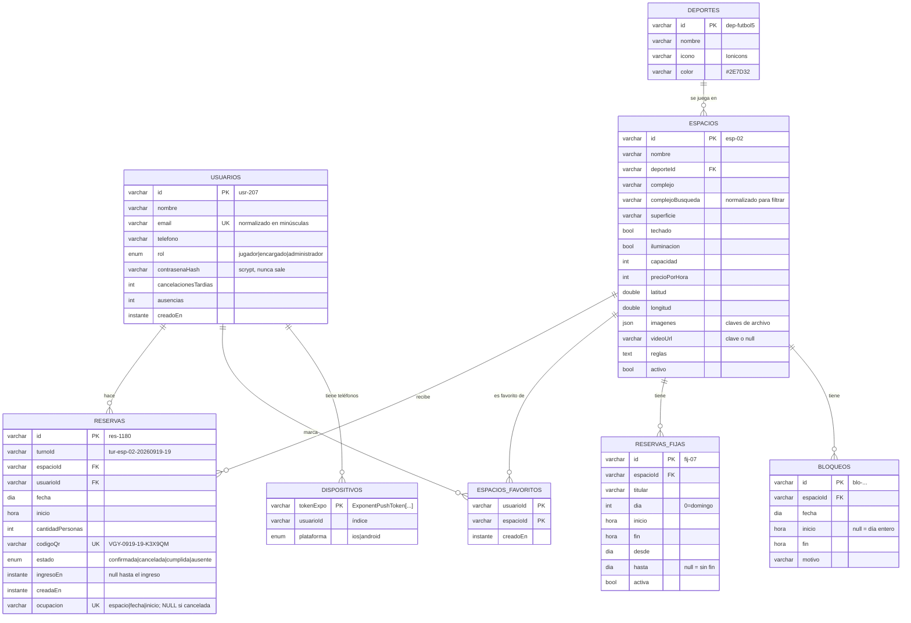

# 06 · Modelo de datos y contrato de la API

## 1. Modelo de datos (base de la API)



Notas de modelado:

- **No hay tabla de turnos.** Un turno es *información derivada*: se calcula cruzando
  `reservas`, `reservas_fijas` y `bloqueos` (ver [03 §5.1](03-api-backend.md)).
- **`reservas.ocupacion`** es la pieza que garantiza que no haya dos reservas en un turno: su
  índice único admite `NULL` repetidos, así que una reserva cancelada deja de ocupar el turno.
- **`espacios_favoritos`** es una tabla propia (clave primaria compuesta) y no una lista dentro
  del usuario, porque se consulta "al revés" (quiénes tienen este espacio de favorito) para
  mandar el aviso de turno liberado.
- **`espacios.imagenes` y `videoUrl`** guardan *claves de archivo*, no URLs; el mapeador las
  convierte en URLs absolutas con la dirección con la que llegó el teléfono.
- **`dispositivos`** es la tabla agregada por el grupo (ver [05](05-notificaciones-push.md)).
- `Bloqueo` no es una entidad del PRD: la agregó la cátedra (decisión D12).

## 2. Convenciones de datos (PRD, "sin excepción")

| Convención | Ejemplo |
|---|---|
| Los ids son **texto** con prefijo | `usr-207`, `esp-02`, `res-1180`, `fij-07`, `dep-futbol5`, `blo-…` |
| Instantes: ISO 8601 **con zona** | `"2026-09-16T21:04:00-03:00"` |
| Un día suelto | `"2026-09-19"` |
| Hora de grilla | `"19:00"`; el último turno termina en `"24:00"` |
| Claves en camelCase | `cantidadPersonas` |
| Sin valor = `null` (no ausente, no `""`) | `videoUrl: null`, `reservaId: null` |
| Precios | número, pesos por hora |
| Sesión | `Authorization: Bearer <token>`; el token se guarda en `expo-secure-store` |
| Sobre de respuesta | `{ datos, meta }` · error `{ error: { codigo, mensaje } }` · `DELETE` ok → **204 sin cuerpo** |
| Paginación | `?pagina=1&porPagina=20` (máx. 100; `/agenda` hasta 500) |

### 2.1 Identificadores especiales

| Qué | Formato | Quién lo genera | Para qué |
|---|---|---|---|
| Id de turno | `tur-<espacioId>-<AAAAMMDD>-<HH>` → `tur-esp-02-20260919-19` | La API (determinístico, no se guarda) | `POST /reservas { turnoId }`. La app lo desarma para mostrar fecha/hora |
| Código QR | `VGY-<MMDD>-<HH>-<6 aleatorios>` → `VGY-0919-19-K3X9QM` | La API al reservar | Lo que se dibuja como QR y escanea el encargado |
| Token de sesión | JWT HS256 (`sub`=id, `rol`, `iat`, `exp` a 30 días) | La API al ingresar/registrar | Cabecera `Authorization` |
| Token de Expo | `ExponentPushToken[...]` | Expo, en el teléfono | `POST /dispositivos` |

## 3. Tipos del PRD (`my-app/src/tipos/index.ts` ≡ `contract/types.ts`)

Se copiaron **literalmente** del PRD y no se modifican cuando llega la API (regla del PRD).
La única diferencia en la app es `Espacio.esFavorito?: boolean` (campo opcional agregado por
el grupo; la API no lo envía).

| Tipo | Campos |
|---|---|
| `Coordenadas` | `latitud`, `longitud` |
| `Espacio` | `id`, `nombre`, `deporteId`, `complejo`, `superficie`, `techado`, `iluminacion`, `capacidad`, `precioPorHora`, `coordenadas`, `imagenes[]`, `videoUrl \| null`, `reglas`, `activo` |
| `Deporte` | `id`, `nombre`, `icono`, `color` |
| `EstadoTurno` | `"libre" \| "reservado" \| "fijo" \| "mantenimiento"` |
| `Turno` | `id`, `espacioId`, `fecha`, `inicio`, `fin`, `estado`, `reservaId \| null`, `motivoBloqueo \| null`, `precio` |
| `EstadoReserva` | `"confirmada" \| "cancelada" \| "cumplida" \| "ausente"` |
| `Reserva` | `id`, `turnoId`, `espacioId`, `usuarioId`, `cantidadPersonas`, `codigoQr`, `estado`, `ingresoEn \| null`, `creadaEn`, `cancelableHasta` |
| `ReservaFija` | `id`, `espacioId`, `titular`, `dia (0..6)`, `inicio`, `fin`, `desde`, `hasta \| null`, `activa` |
| `Rol` | `"jugador" \| "encargado" \| "administrador"` |
| `Usuario` | `id`, `nombre`, `email`, `telefono`, `rol`, `espaciosFavoritos[]`, `cancelacionesTardias`, `ausencias` |

Tipos que agrega la API (`contract/api.ts`): `Meta`, `RespuestaLista<T>`, `RespuestaUno<T>`,
`RespuestaError`, `Bloqueo`, `Sesion { token, usuario }`, `ArchivoSubido`, `Salud`,
`Dispositivo { tokenExpo, plataforma }`, `PruebaDePush { dispositivos }`.

### 3.1 Ejemplo: una `Reserva` real

```json
{
  "datos": {
    "id": "res-1180",
    "turnoId": "tur-esp-02-20260919-19",
    "espacioId": "esp-02",
    "usuarioId": "usr-207",
    "cantidadPersonas": 10,
    "codigoQr": "VGY-0919-19-K3X9QM",
    "estado": "confirmada",
    "ingresoEn": null,
    "creadaEn": "2026-09-16T21:04:00-03:00",
    "cancelableHasta": "2026-09-19T15:00:00-03:00"
  },
  "meta": null
}
```

## 4. Endpoints

🌐 público · 🔒 con sesión · 🧑‍🔧 `encargado`/`administrador` · 🛡 sólo `administrador`.
**"App"** indica si la app móvil lo llama hoy.

| Método | Ruta | Acceso | App | Descripción |
|---|---|---|---|---|
| GET | `/salud` | 🌐 | — | Estado, motor de base, almacén, versión |
| POST | `/auth/registro` | 🌐 | ✅ | `{ nombre, email, contrasena, telefono }` → 201 `{ token, usuario }` |
| POST | `/auth/ingreso` | 🌐 | ✅ | `{ email, contrasena }` → 200 `{ token, usuario }` |
| GET | `/yo` | 🔒 | ✅ | Usuario actual (incluye `espaciosFavoritos`) |
| PATCH | `/yo` | 🔒 | ✅ | `{ nombre?, telefono? }` |
| PUT | `/yo/espacios-favoritos/:espacioId` | 🔒 | ✅ | Agrega favorito (200 con el usuario) |
| DELETE | `/yo/espacios-favoritos/:espacioId` | 🔒 | ✅ | Quita favorito (204) |
| GET | `/yo/reservas?cuando=proximas\|pasadas` | 🔒 | ✅ | Mis reservas |
| GET | `/deportes` | 🌐 | ✅ | Deportes |
| GET | `/espacios` | 🌐 | ✅ | Espacios activos; filtros `deporteId`, `complejo`, `iluminacion`, `techado` |
| GET | `/espacios/:id` | 🌐 | ✅ | Detalle |
| GET | `/espacios/:id/turnos?fecha=` | 🌐 | ✅ | Los 16 turnos del día (hoy…hoy+6) |
| POST | `/reservas` | 🔒 jugador | ✅ | `{ turnoId, cantidadPersonas }` → 201 (o 200 si ya la tenía) |
| GET | `/reservas/:id` | 🔒 | — | Una reserva (dueño o personal) |
| POST | `/reservas/:id/cancelacion` | 🔒 | ✅ | Cancela (hasta `cancelableHasta`) |
| GET | `/reservas` | 🧑‍🔧 | — | Reservas de todos (`fecha`, `espacioId`, `estado`) |
| POST | `/ingresos` | 🧑‍🔧 | ✅ | `{ codigoQr, espacioId }` → reserva `cumplida` |
| POST | `/reservas/:id/ausente` | 🧑‍🔧 | — | "No se presentó" |
| GET | `/agenda` | 🧑‍🔧 | — | Turnos de todos los espacios en un día |
| GET | `/usuarios/:id` | 🧑‍🔧 | — | Usuario con teléfono |
| POST / GET / DELETE | `/bloqueos` | 🧑‍🔧 | — | Bloquear, listar, quitar |
| GET | `/fijas` | 🧑‍🔧 | — | Reservas fijas |
| POST / PATCH / DELETE | `/fijas` · `/fijas/:id` | 🛡 | — | Alta, edición, baja de fijas |
| PATCH | `/espacios/:id` | 🛡 | — | `{ precioPorHora }` |
| POST | `/archivos` | 🔒 | ❌ | Subir foto/audio/video |
| GET | `/archivos/:clave` | 🌐 | (indirecto) | Servir archivo (admite `Range`) |
| POST | `/dispositivos` | 🔒 | ✅ | Anotar el teléfono para push |
| DELETE | `/dispositivos/:tokenExpo` | 🔒 | ✅ | Dar de baja el teléfono |
| POST | `/dispositivos/prueba` | 🔒 | — | Push de prueba |

### 4.1 Cómo debe manejar errores un cliente

1. **Mirar `error.codigo`** para decidir qué hacer (es estable). **Mostrar `error.mensaje`** tal
   cual al usuario (está pensado para eso).
2. Códigos que conviene tratar distinto: `NO_AUTENTICADO` (ir a login), `TURNO_OCUPADO` (volver
   a cargar la grilla), `LIMITE_DE_RESERVAS`, `CANCELACION_FUERA_DE_PLAZO` (decir que avise al
   encargado), `VALIDACION_FALLIDA` (mostrar el mensaje).
3. Un fallo de red es distinto de un error de la API: no hay cuerpo. La app lo detecta antes
   con `Network.getNetworkStateAsync()`.

> La app lo hace con `servicios/errores.ts` (`lanzarSiError`, `codigoDe`, `mensajeDe`): ver
> [04 §3.5](04-app-movil.md).

## 5. Datos de demo

Contraseña común: `villaguay2026`.

| Email | Rol | Datos |
|---|---|---|
| `emiliano@mail.com` (`usr-207`) | jugador | Reservas próximas/pasadas; `esp-02` favorito; una cancelación tardía |
| `lleno@demo.ar` | jugador | Tres reservas activas |
| `nuevo@demo.ar` | jugador | Sin datos |
| `marcelo@villaguay.demo.ar` | encargado | |
| `nahuel@villaguay.demo.ar` | administrador | |

Casos especiales: pasado mañana, día entero bloqueado en canchas descubiertas ("Cancha
anegada"); `esp-04` mañana sin turnos libres; `fij-07` "Grupo de los martes" en `esp-02`
(21–22); una fija de dos horas en `esp-03`; bloqueo parcial en `esp-09` (10–12); ningún espacio
con video.
