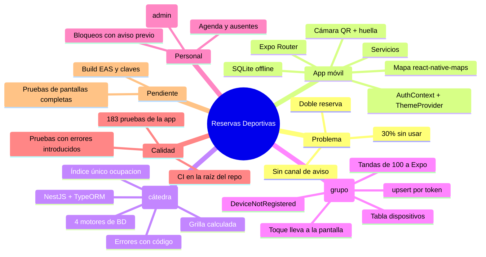

# 09 · Guía para la defensa oral

Pensada para que **cada integrante** pueda explicar cualquier parte del sistema. Incluye
guiones de exposición, un reparto sugerido, una demostración paso a paso y las preguntas más
probables con sus respuestas.

## 1. Reglas de oro

1. **Decir siempre qué es nuestro y qué es de la cátedra.** La API y el PRD son de la cátedra;
   la app móvil y las notificaciones push son del grupo. Nadie pierde puntos por eso; sí por
   atribuirse lo ajeno (ver [00 §2](00-indice.md)).
2. **No esconder los límites.** Mejor decir "esto está simulado y así lo completaríamos" que
   que el docente lo descubra (ver [08](08-estado-actual-y-deuda-tecnica.md)).
3. **Explicar el *por qué***, no sólo el *qué*: cada decisión tiene una razón en este
   documento.
4. Hablar de **problema → solución → evidencia** (un test, una pantalla, una línea de código).

## 2. Guion de 1 minuto ("ascensor")

> "La Dirección de Deportes de Villaguay manejaba once canchas con un teléfono y una libreta, y
> el mes pasado tuvo dobles reservas, una lluvia sin poder avisar a seis grupos y un 30 % de
> turnos sin usar. Hicimos una app móvil en React Native con Expo y TypeScript, conectada a
> una API NestJS que provee la cátedra. El jugador ve la disponibilidad de los próximos siete
> días, reserva en dos toques, recibe un QR que sigue viendo sin señal, y cancela con un botón.
> La doble reserva es imposible porque la garantiza un índice único en la base, no la
> pantalla. Además, cuando el encargado bloquea una cancha por lluvia, los afectados reciben
> una notificación push. Nosotros programamos toda la app y completamos el módulo de
> notificaciones de la API."

## 3. Guion de 5 minutos

| Min | Tema | Qué decir | Documento |
|---|---|---|---|
| 0:00 | Problema | Los tres incidentes del PRD y por qué un sistema único los evita | [01](01-planificacion-y-requerimientos.md) |
| 0:45 | Alcance | Qué entra (espacios, reservas, QR, avisos, personal) y qué no (pagos) | [01](01-planificacion-y-requerimientos.md) |
| 1:15 | Arquitectura | Diagrama: app ↔ API ↔ base ↔ Expo push; capa de servicios | [02](02-arquitectura.md) |
| 2:00 | Decisión central | La grilla se calcula en el servidor; el turno no se guarda; índice único | [03](03-api-backend.md) |
| 2:45 | La app | Pestañas, flujo ficha → disponibilidad → confirmar → QR; sesión en SecureStore | [04](04-app-movil.md) |
| 3:30 | Offline | Caché de Mis Reservas en SQLite; por qué (mala señal en la cancha) | [02 §5.3](02-arquitectura.md) |
| 4:00 | Capacidades nativas | Cámara/QR, biometría, ubicación, háptica, galería, video | [04 §6](04-app-movil.md) |
| 4:30 | Notificaciones | Puertos y adaptadores; token → Expo; `DeviceNotRegistered` | [05](05-notificaciones-push.md) |
| 5:00 | Límites | Qué falta y cómo lo cerraríamos | [08](08-estado-actual-y-deuda-tecnica.md) |

## 4. Reparto sugerido de temas (COMPLETAR con los nombres)

Que cada uno **domine uno a fondo y conozca los demás a nivel general**.

| Integrante | Tema a fondo | Documento y archivos clave |
|---|---|---|
| `COMPLETAR` | Sesión, seguridad y perfil | [04 §2.1, §4.1, §4.2, §4.10](04-app-movil.md) · `AuthContext.tsx`, `servicios/auth.ts`, `app/index.tsx` |
| `COMPLETAR` | Catálogo, ficha, grilla y reserva | [04 §4.3–§4.6](04-app-movil.md) · `espacios.tsx`, `[id].tsx`, `disponibilidad.tsx`, `confirmar.tsx` |
| `COMPLETAR` | Mis reservas, offline, QR y escáner, mapa | [04 §4.7–§4.9](04-app-movil.md) · `(tabs)/index.tsx`, `escaner.tsx`, `mapa.tsx` |
| `COMPLETAR` | Notificaciones push (API + app) | [05](05-notificaciones-push.md) · `student-notifications/*`, `servicios/notificaciones.ts`, `_layout.tsx` |
| `COMPLETAR` | La API: reglas, grilla, concurrencia, errores | [03](03-api-backend.md), [06](06-modelo-de-datos-y-contrato.md) |

## 5. Demostración sugerida (5–7 minutos)

Preparación: API con datos de demo (`pnpm db:reiniciar`), `NOTIFICACIONES=expo`, dos teléfonos
(o un teléfono y Swagger), Expo Go / build instalado.

1. **Sin cuenta:** abrir Canchas, filtrar por deporte, entrar a una ficha. *"No pedimos cuenta
   para mirar."*
2. **Grilla:** ver disponibilidad; mostrar un día bloqueado y un turno de reserva fija (martes
   21 en `esp-02`). *"El servidor decide la prioridad: mantenimiento > fija > reservado."*
3. **Reservar:** iniciar sesión con `emiliano@mail.com` / `villaguay2026` → turno libre →
   confirmar → mostrar el QR.
4. **Sin señal:** modo avión → Mis Reservas muestra el cartel y el QR guardado.
5. **Doble reserva:** con el segundo teléfono, intentar el mismo turno → "Ese turno ya fue
   reservado." con el botón *Ver otros turnos*.
6. **Notificación:** en otro teléfono, ingresar como encargado (`marcelo@villaguay.demo.ar`) →
   menú ☰ → **Bloqueos** → Nuevo → elegir el espacio y el día del turno reservado por el primer
   teléfono, apagar "Todo el día" y fijar el tramo, escribir el motivo (la app avisa "1 reserva
   confirmada se va a cancelar") → Bloquear → llega "Reserva cancelada" al primer teléfono →
   tocar → abre Mis Reservas.
7. **Escáner, agenda y bloqueos:** ingresar como encargado (`marcelo@villaguay.demo.ar`), abrir el escáner (ícono
   QR, huella) y escanear el QR de la reserva del otro teléfono → "¡Ingreso autorizado!".
   Escanearlo de nuevo → "Ingreso rechazado" (ya ingresó).

> **Plan B si algo falla en vivo:** mostrar `pnpm test:notificaciones` (25 tests en verde) y
> los logs de la API con `NOTIFICACIONES=registro`.

## 6. Preguntas probables y respuestas

### Producto y planificación

**¿Qué problema resuelve y para quién?** Para la Dirección de Deportes de Villaguay: elimina
la doble reserva, permite avisar a los afectados cuando se cierra una cancha y reduce los
turnos no usados (cancelación fácil, recordatorios, registro de ausentes).

**¿Qué quedó fuera de alcance y por qué?** Pagos/señas, torneos, armado de equipos, canchas
privadas y alquiler de elementos: el PRD los excluye de la primera versión. La app muestra el
precio pero no cobra.

**¿Qué requisitos del PRD no pudieron cumplir?** Hay que responder con la tabla de
[08 §3](08-estado-actual-y-deuda-tecnica.md): quedan límites menores (no se editan las reservas
fijas y un bloqueo cubre un solo día) y el build de producción con EAS, que depende de las cuentas
del grupo. Y explicar cómo se cerrarían.

**¿Cómo se organizó el trabajo?** (Completar con el reparto real.) La secuencia técnica fue:
base y navegación → catálogo → disponibilidad y reserva → sesión → Mis reservas y offline →
capacidades nativas → conexión a la API → notificaciones ([01 §6](01-planificacion-y-requerimientos.md)).

### Arquitectura

**¿Por qué cliente–servidor y no sólo la app?** Porque la verdad de las reservas debe estar en
un único lugar compartido por todos (jugadores y encargados); una base local no evita dobles
reservas.

**¿Por qué React Native + Expo?** Lo pide el PRD: un solo código para Android e iPhone y acceso
simple a cámara, ubicación, notificaciones, SQLite, etc., sin escribir código nativo.

**¿Por qué una capa de servicios?** Para que las pantallas no sepan *de dónde* vienen los datos
(mocks al principio, API después) y poder cambiarlo sin tocarlas. (Y decir honestamente que
algunas pantallas la saltan: D-04.)

**¿Qué patrón usa la API?** Capas (controlador → servicio → reglas puras → repositorio),
inyección de dependencias de NestJS, y puertos y adaptadores para notificaciones y archivos.

**¿Cómo se comunican app y API?** HTTP/JSON, sobre `{ datos, meta }` / `{ error }`, con
`Authorization: Bearer <jwt>`. Los tipos del PRD son el contrato.

### Reservas y datos

**¿Cómo evitan que dos personas reserven el mismo turno?** La columna `ocupacion`
(`espacio|fecha|inicio`) tiene índice único y vale `NULL` en las canceladas. Si dos insertan a
la vez, la base rechaza una y la API la traduce a `TURNO_OCUPADO`. El chequeo previo de la grilla
es sólo amigable. Hay un test que dispara dos `POST` simultáneos.

**¿Por qué el turno no está en la base?** Es derivable: 16 horas × espacio × día cruzado con
reservas, fijas y bloqueos. Guardarlo exigiría generar y mantener millones de filas.

**¿Cómo se arma el id del turno y para qué sirve?** `tur-<espacio>-<AAAAMMDD>-<HH>`; es
determinístico, así que se calcula en la grilla y se desarma al reservar. La app lo desarma
también para mostrar fecha y hora (acoplamiento: D-07).

**¿Qué pasa si reintento por mala señal?** `POST /reservas` es idempotente: si ya tenés ese
turno responde 200 con la misma reserva.

**¿Cómo funcionan las reservas fijas?** Son una regla semanal (día, horas, desde/hasta). La
grilla las cruza por día de la semana *en hora argentina* y las muestra como `fijo`.

**¿Cuándo se puede cancelar?** Hasta 4 horas antes (`cancelableHasta`). El encargado puede
siempre; si es tarde, suma una "cancelación tardía" al jugador.

### La app

**¿Dónde se guarda la sesión y por qué ahí?** En `expo-secure-store` (Keychain / Keystore). El
PRD prohíbe `kv-store` para el token porque no es seguro.

**¿Cómo funciona lo offline?** Hay tres cosas guardadas en el teléfono: las reservas con su QR,
el catálogo (espacios y deportes) y la foto y el video de cada ficha ya vista. Para las reservas: al cargar Mis Reservas con red, se guardan las reservas y los
espacios en SQLite (`cache_reservas`, clave = filtro). Sin red (`Network.getNetworkStateAsync`)
se leen de ahí y se muestra el cartel. El QR se dibuja de `codigoQr`, que va incluido en la
reserva.

**¿Por qué `react-native-maps` y no un mapa web?** El PRD lo indica para "complejos en el mapa y
cómo llegar", y es un mapa nativo: más fluido, sin cargar scripts de un CDN y con el punto de
ubicación del sistema. Usa Google Maps en Android y Apple Maps en iPhone. El costo es que los
builds de Android necesitan una clave de Google Maps (`GOOGLE_MAPS_API_KEY`); en Expo Go no hace
falta.

**¿Qué muestra el mapa?** Un marcador por complejo; al tocarlo, una tarjeta con sus canchas, la
distancia (si hay ubicación) y el botón "Cómo llegar". El más cercano al usuario va en verde.

**¿Qué pasa si niegan el permiso de ubicación/cámara?** Ubicación: el mapa funciona igual sin el
punto azul. Cámara: una pantalla explica y ofrece reintentar. Notificaciones: no se registra el
token y la app sigue funcionando.

**¿Qué hace el `ThemeProvider`?** Provee la paleta clara u oscura según el sistema o la
elección manual del perfil. (No persiste: B-09.)

**¿Qué es `useFocusEffect` y por qué lo usan?** Ejecuta código cada vez que la pantalla gana el
foco (volver a la pestaña), no sólo al montarse; así Mis Reservas se actualiza tras reservar.

**¿Para qué la bandera `estaActivo` en la grilla?** Evita *condiciones de carrera*: si el
usuario cambia de día antes de que llegue la respuesta anterior, se ignora la respuesta vieja.

**¿Por qué `openDatabaseSync` y no la versión asíncrona?** El código lo comenta: para evitar
crasheos en Android. Es una decisión pragmática.

### Notificaciones

**¿Cómo funcionan las notificaciones push?** Ver [05 §1](05-notificaciones-push.md): el teléfono
obtiene un token de Expo y lo registra en la API; cuando hay un evento, la API busca los tokens
de los afectados y le pide a Expo que los entregue.

**¿Qué hicieron ustedes en la API?** Dos piezas: guardar/leer/descartar tokens
(`AlmacenTokensPorHacer`, con `upsert`) y enviar a Expo en tandas de 100 leyendo los tickets
(`EnviadorPorHacer`). Más la entidad y el registro en el módulo.

**¿Por qué no funciona en Expo Go con Android?** Desde SDK 53 Expo Go en Android no soporta push
remotas; se necesita un development build. En iPhone sí.

**¿Cómo funciona el recordatorio de 2 horas?** Es una notificación **local**: al reservar, la
app la programa en el teléfono con `scheduleNotificationAsync` (disparador por fecha = inicio −
2 h, identificador `recordatorio-<reservaId>`). No necesita servidor ni señal. Se cancela al
cancelar la reserva o cerrar sesión y se reconcilia cada vez que se cargan "Mis reservas".

**¿Qué puede hacer el personal en la app?** El **encargado** escanea el QR para registrar el
ingreso y, desde el menú ☰, usa la **Agenda del día** (reservas, contacto, marcar ausentes) y
**Bloqueos** (cerrar turnos por lluvia o mantenimiento). El **administrador** además maneja las
**reservas fijas** y los **precios**. La interfaz limita cada pantalla por rol y la API vuelve a
validarlo.

**¿Qué pasa cuando el encargado bloquea un turno con reservas?** Antes de confirmar, la app
consulta las reservas del día y avisa cuántas se van a cancelar. Al confirmar, la API crea el
bloqueo, cancela esas reservas (sin contarlas como cancelación tardía) y manda una push con el
motivo a cada dueño. Quitar el bloqueo después libera los turnos pero **no** revive las reservas.

**¿Cómo funciona el marcado de ausentes?** `POST /reservas/:id/ausente`: sólo para una reserva
`confirmada` y desde 15 minutos después del inicio; queda `ausente`, suma 1 a las `ausencias` del
jugador (el contador del perfil) y repetirlo no cambia nada. La app deshabilita el botón antes de
tiempo, pero la regla la valida el servidor.

### Entrega

**¿Cómo generan la app para instalarla?** Con EAS Build: `eas build --platform android --profile
preview` produce un APK instalable y `production` un AAB para Google Play. `eas.json` define los
perfiles y la URL de la API de cada uno ([README §5](../README.md)).

**¿Por qué la API del build tiene que ser https?** Android e iOS bloquean el tráfico `http://` sin
cifrar en las apps de producción; sólo Expo Go y el development client lo permiten.

**¿Por qué configuran permisos en `app.json` si Expo Go anda sin eso?** Expo Go ya trae los
textos de permisos; un build propio no. Sin los plugins, en iOS falta el texto de cámara,
ubicación o fotos y el sistema cierra la app al pedirlo.

### Calidad y seguridad

**¿Cómo probaron?** La API trae ~300 tests unitarios, ~1.160 e2e y 25 de notificaciones, que
corren en el CI contra 4 motores de base de datos. La app tiene **183 pruebas automáticas** (Jest,
`jest-expo` y Testing Library, `npm test`, unos 8 segundos) sobre la lógica de negocio, los
servicios con la API simulada, la sesión, las notificaciones, el caché y los componentes de
formulario. Lo que depende de pantallas completas, de la navegación y del teléfono (cámara, mapa,
push reales) se prueba a mano con el plan de 76 casos de [07 §5](07-pruebas-y-calidad.md).

**¿Cómo saben que las pruebas sirven?** Se introdujeron doce errores a propósito (por ejemplo,
usar la fecha UTC en la grilla, o cerrar sesión antes de dar de baja el teléfono) y se verificó que
alguna prueba se rompiera. Una de ellas no se detectaba porque la computadora estaba en UTC: por
eso las pruebas fijan la zona horaria de Argentina.

**¿Qué cubren y qué no?** Cubren 95,1 % de las sentencias de servicios, sesión y componentes. No
renderizan las pantallas completas ni usan un teléfono real ([07 §4.6](07-pruebas-y-calidad.md)).

**¿El CI corre las pruebas?** `.github/workflows/app.yml` ejecuta `npm ci`, `tsc`, las pruebas y
una validación de la configuración de Expo; `api.yml` es el CI de la cátedra adaptado al monorepo
(el original, dentro de la carpeta de la API, GitHub no lo ejecutaba).

**¿Cómo protegen las contraseñas?** `scrypt` con sal aleatoria; el hash nunca sale en una
respuesta. El servidor compara en tiempo constante y simula la verificación aunque el email no
exista (evita enumerar usuarios).

**¿Qué riesgos de seguridad ven en la app?** `http://` en desarrollo (en producción debe ser
`https://`) y que el token dura 30 días sin renovación (al vencer, la app cierra la sesión sola).

### Preguntas "trampa"

**"Mostrame el código que valida el QR en la app."** La app no valida: manda el código a
`POST /ingresos` (`registrarIngresoApi`) y muestra el mensaje de la API. Las reglas (código
inexistente, de otro día, de otra cancha, ya usado, fuera de horario) están en
`check-ins/rules/check-in.ts`.

**"¿Por qué el filtro por deporte se hace en la app si la API filtra?"** Porque con 11 espacios
es más simple y rápido filtrar en memoria; sería necesario filtrar en el servidor con cientos
de espacios (D-03).

**"Si cambia la IP de la computadora, ¿qué pasa?"** Se cambia `EXPO_PUBLIC_API_URL` en el
`.env.local` de la app y se reinicia Expo con `-c`. En producción la app apuntaría a la URL pública de la API (Render).

**"¿Y si dos encargados bloquean a la vez el mismo turno?"** El bloqueo corre en una
transacción; cancelar una reserva dos veces es idempotente a nivel de estado (queda cancelada).

## 7. Mapa mental para estudiar (una página)

